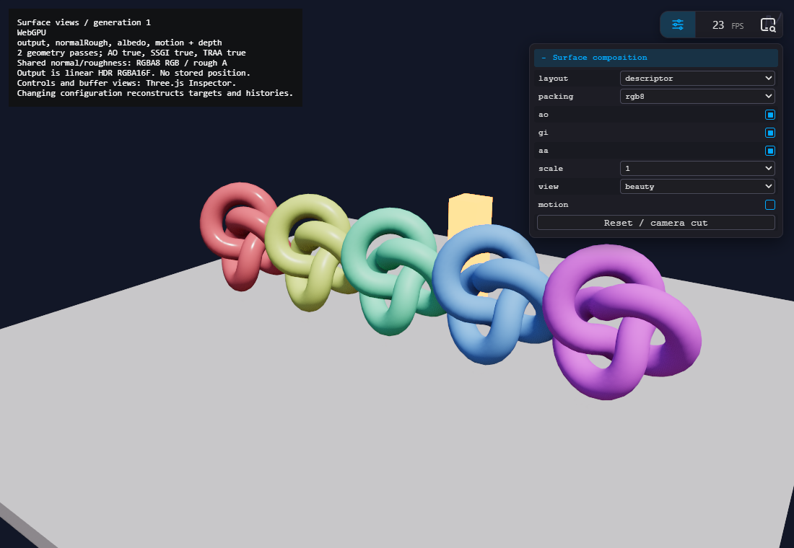
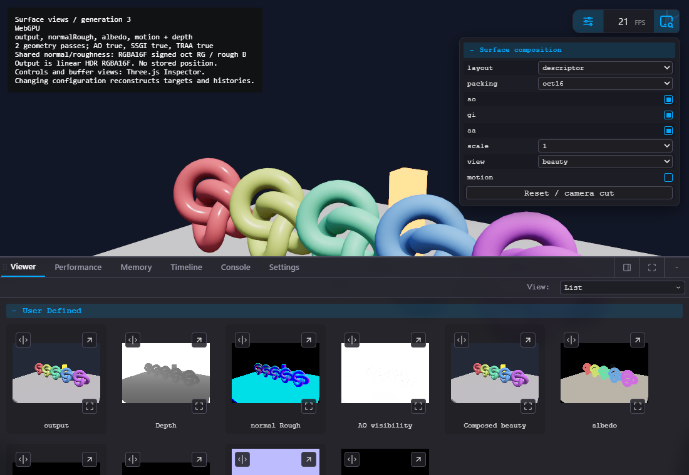
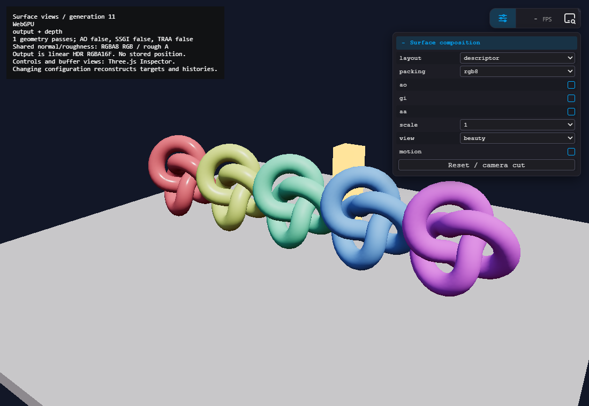

# Composable surface resources in TSL: findings and prototype

**Recommendation:** use **A, ordinary PassNode/MRTNode plus documented composition functions, as the default**. A small **B, surface layout/codec descriptor, is useful when an application actually needs interchangeable packing**. Keep surface semantics separate from later lighting, temporal history and resource lifetime. This study does not justify a mandatory GBuffer class or full frame graph.

The new independent [draft PR #74](https://github.com/bhouston/three.js/pull/74), branch `composable-surface-passes`, demonstrates both A and B in one AO + SSGI + TRAA composition. The descriptor helper changes configuration validation and field access, not effect algorithms or renderer scheduling. No FPS improvement is claimed.

## Revision and evidence

Fork `dev` was inspected first and pinned to [`d7848108d3c2b93c322b99fe41b4c3dbafa620b5`](https://github.com/bhouston/three.js/commit/d7848108d3c2b93c322b99fe41b4c3dbafa620b5). PR #74 starts from that exact commit and targets fork `dev`; it does not depend on the independent SSR/deferred studies. Existing branches and PRs were preserved.

Upstream `mrdoob/three.js` dev resolved to [`c46746f581ee5db57aaa3c359ad74be6864248da`](https://github.com/mrdoob/three.js/commit/c46746f581ee5db57aaa3c359ad74be6864248da). A scoped comparison found identical PassNode, MRTNode, OutputStructNode, RenderPipeline, NodeFrame, and AO/SSR/SSGI/deferred example contents after newline/trailing-whitespace normalization. Those findings are shared by these two revisions; this is not a whole-tree equivalence claim. Temporal-denoiser/VXGI-specific observations remain pinned fork findings unless separately compared.

The complete source matrices and line references are in [example audit](tsl_surface_layout/example-audit.md), [core audit](tsl_surface_layout/core-audit.md), and [other-engine research](tsl_surface_layout/engine-research.md). These distinguish source descriptors from observed GPU allocations. The [draft PR](https://github.com/bhouston/three.js/pull/74) and initiating issue pin the final head and verified raw.githack demos. [Hardware evidence](tsl_surface_layout/validation.json) records the complete target inventory and assertions; screenshots appear below.

## Direct answers about depth and AO

**AO examples use surface MRTs; their prepasses are not demonstrated depth-reuse overdraw optimizations.** AO writes normal, velocity and depth; GTAO/SSAO samples these, then `builtinAOContext` integrates AO into a separate beauty geometry pass. The beauty pass does not attach the prepass depth and rasterizes fresh depth. VXGI/VXGI Sponza and screen-space shadows use the same two-geometry-pass/context pattern. The file named `webgpu_postprocessing_sss.html` is screen-space shadows, not subsurface scattering. See [AO L119–180](https://github.com/bhouston/three.js/blob/d7848108d3c2b93c322b99fe41b4c3dbafa620b5/examples/webgpu_postprocessing_ao.html#L119-L180).

**No true depth-only prepass followed by shared-depth shading/overdraw rejection was found in the audited WebGPU examples.** Search covered all `examples/webgpu*.html` for depthPass, external depth textures, depth assignment, autoClearDepth, depthFunc, count:0 and colorWrite:false. Volume-lighting TRAA samples a depthPass result but renders its later scene with independent depth. At this revision `depthPass()` selects the returned depth scope while still constructing a normal color target; `depthPass(...,{count:0})` fails at the unconditional default texture access. The name alone is not a hardware depth-only pass. [PassNode constructor/setup](https://github.com/bhouston/three.js/blob/d7848108d3c2b93c322b99fe41b4c3dbafa620b5/src/nodes/display/PassNode.js#L252-L280).

The positive shared-depth case is [deferred L217–222](https://github.com/bhouston/three.js/blob/d7848108d3c2b93c322b99fe41b4c3dbafa620b5/examples/webgpu_deferred.html#L217-L222): opaque MRT depth is attached to transparent geometry with `autoClearDepth:false`. Its purpose is opaque/transparent occlusion; opaque MRT generation is not a cheap depth-only prepass. Materials retain normal depth tests rather than selecting an EqualDepth prepass arrangement. Depth sampling and depth attachment reuse are different dependencies.

## Audit and migration priorities

RGBA16F below means a physical four-component attachment, not merely a vec4 logical expression. A vec2 MRT expression does not automatically allocate RG storage. Attachment-zero type is also special: PassNode.setup resets its type to renderer output type; several normal RGBA8 assignments/comments therefore require runtime verification.

| Examples | Geometry/surface and downstream chain | Depth/history conclusion | Migration value |
|---|---|---|---|
| AO; VXGI; VXGI Sponza | Normal + velocity + depth producer → AO/GI → material context → separate beauty → TRAA | Fresh beauty depth; TRAA owns histories. Voxel volumes are separate compute resources. | **1:** remove repeated type/decode/Inspector/motion wiring; preserve material integration. |
| Screen-space shadows (`sss`) | Velocity + depth → shadow visibility → light context → beauty → TRAA | No normal target; no depth reuse. | Proves minimal fields depend on consumers. |
| SSR | Lit HDR + packed normal + metal/rough + depth → SSR → add reflection → SMAA | One geometry pass; no example-owned motion/history. | **2:** straightforward packing/semantic accessor comparison. |
| SSGI; SSGI ballpool | Lit HDR + normal + diffuse + motion + depth → AO/GI attachments → composite → TRAA | One geometry pass. Existing composite multiplies all beauty by AO; do not standardize that treatment of direct/emission light. | **2:** later producer resources; ballpool adds instancing stress. |
| SSR denoise | Packed normal/roughness + diffuse/metalness + motion + depth → raw SSR → temporal → spatial → composition/AA | Explicit filtered feedback; alpha means ray length at one stage and inverse history age at another. Temporal/denoise code assumes packed RGB normal. | **4:** semantic history contracts must precede migration. |
| Deferred | Unlit opaque albedo/position+metal/normal+rough MRT → material-based lighting resolve; transparent geometry | Opaque depth is reused by transparents without clear; resolve owns separate sampled-depth output. Stored position is optional design, not a requirement. | Integration/depth attachment stress case; retain custom material escape hatches. |
| MRT; mask; direct MRT/readback | Named MRT outputs, per-material masks, explicit external targets/readback | Direct examples render manually and use plain texture nodes. Their names do not create producer edges. | Keep explicit as teaching/baseline and ownership escape-hatch examples. |
| TRAA/TAAU; motion blur; DOF | Minimal color+motion+depth, motion-only or color+viewZ consumers | Different input/output/history resolutions; no need for a universal normal-heavy G-buffer. | **3:** low presets, depth conventions and temporal compatibility. |
| Emissive/selective bloom; water; volume lighting TRAA | Optional emissive/mask, transparency, custom depth and output transforms | Some examples encode emissive as unorm; HDR is a separate contract. Water example audited is FXAA, not TRAA. | Follow-up blend/HDR/custom-material tests. |

Legacy WebGL `gtao`, `ssao`, `sao` use EffectComposer plus separate override-material normal/depth rendering for sampled AO inputs. `GTAOPass.setGBuffer(depth,normal)` can import caller-owned textures and suppress its internal geometry render; SSAOPass/SAOPass have no equivalent public hook. These are useful contrasts, not a reason to retrofit the legacy renderer. [GTAOPass hook L295–349](https://github.com/bhouston/three.js/blob/d7848108d3c2b93c322b99fe41b4c3dbafa620b5/examples/jsm/postprocessing/GTAOPass.js#L295-L349).

## What TSL already supplies

`getTextureNode(name)` both creates/caches a named physical attachment and returns a PassMultipleTextureNode. Its setup publishes `properties.passNode`; Node.build recursively builds properties before adding sequential nodes; NodeBuilder creates ordered update lists; NodeFrame deduplicates FRAME producers by node reference/frame ID, marking before invocation. A decoded graph that retains that texture node retains this dependency. Multiple consumers/Inspector views need not run the same producer again in that frame. [PassTextureNode L66–71](https://github.com/bhouston/three.js/blob/d7848108d3c2b93c322b99fe41b4c3dbafa620b5/src/nodes/display/PassNode.js#L66-L71), [Node.build L1164–1208](https://github.com/bhouston/three.js/blob/d7848108d3c2b93c322b99fe41b4c3dbafa620b5/src/nodes/core/Node.js#L1164-L1208), [NodeFrame L155–198](https://github.com/bhouston/three.js/blob/d7848108d3c2b93c322b99fe41b4c3dbafa620b5/src/nodes/core/NodeFrame.js#L155-L198).

This is useful dependency traversal, with practical limits:

- Raw `getTexture()` plus a plain TextureNode or attaching a DepthTexture creates no producer relationship. `Node.before(producer)` is an existing explicit build-order hook, not a resource hazard validator.
- `MRTNode.setup()` ignores declarations with no allocated matching attachment. Once `getTextureNode()` created an attachment, removing a consumer or changing MRT does not remove it. Reconstruct the pass for smaller layouts.
- A shared packed attachment writes all its declared channels when any field activates it. There is no automatic channel pruning/repacking.
- `getPreviousTextureNode()` carries the same producer edge and swaps before the producer renders; it is not an independent temporal-edge scheduler. Previous-depth toggle incorrectly indexes the color attachment array in this revision. TRAA instead owns/copies separate depth history.
- Material/context dependencies can first be discovered during nested geometry rendering. Node traversal is not a whole-frame access graph and provides no general cycle/hazard/lifetime guarantee.
- PassNode.dispose/RenderPipeline.dispose do not recursively dispose every effect/history. An application must own/dispose its composition. Structural graph changes require shader/material/render-object cache invalidation, not just replacing a dictionary.

[MRT allocation/setup](https://github.com/bhouston/three.js/blob/d7848108d3c2b93c322b99fe41b4c3dbafa620b5/src/nodes/core/MRTNode.js#L251-L278), [history swap](https://github.com/bhouston/three.js/blob/d7848108d3c2b93c322b99fe41b4c3dbafa620b5/src/nodes/display/PassNode.js#L663-L705), [RenderPipeline](https://github.com/bhouston/three.js/blob/d7848108d3c2b93c322b99fe41b4c3dbafa620b5/src/renderers/common/RenderPipeline.js#L135-L189).

## A versus B: actual composition shape

A needs no container. The essential pattern already fits ordinary sampleable TSL nodes:

```js
const surfacePass = pass( scene, camera, { samples: 0 } );
surfacePass.setMRT( mrt( {
  output,
  normalRough: vec4( packNormalToRGB( normalView ), roughness ),
  motion: velocity
} ) );
const packed = surfacePass.getTextureNode( 'normalRough' );
Object.assign( surfacePass.getTexture( 'normalRough' ), {
  type: THREE.UnsignedByteType,
  minFilter: THREE.NearestFilter, magFilter: THREE.NearestFilter
} );
const surface = Object.freeze( {
  depth: surfacePass.getTextureNode( 'depth' ),
  normal: sample( uv => unpackRGBToNormal( packed.sample( uv ).rgb ).normalize() ),
  roughness: sample( uv => packed.sample( uv ).a ),
  motion: surfacePass.getTextureNode( 'motion' )
} );
const aoRaw = ao( surface.depth, surface.normal, camera );
const shaded = pass( scene, camera, { samples: 0 } );
shaded.contextNode = builtinAOContext( aoRaw.getTextureNode().sample( screenUV ).r );
// This beauty pass has independent depth. No depth-reuse optimization claimed.
const aa = traa( shaded.getTextureNode(), surface.depth, surface.motion, camera );
```

Keep depth a physical texture node where effects need `.value`, `.gather()` or other depth operations. Normal/roughness can be `sample(callback)` views: effects can sample arbitrary UVs without adding a decode render target. Existing AO/SSR/SSGI accept this shape; fork temporal/recurrent denoisers still hard-code RGB normal decoding and need a separate contract change to accept oct views.

B moves repeated packing/access validation into the prototype's `surfaceLayout` function. This is the actual descriptor shape, with arbitrary output names rather than a fixed semantic list:

```js
const layout = surfaceLayout( source, {
  attachments: {
    output: { node: output }, // PassNode owns attachment-zero type
    normalRough: {
      node: vec4( octEncode( normalView ), roughness, 0 ),
      texture: { type: THREE.HalfFloatType,
        minFilter: THREE.NearestFilter, magFilter: THREE.NearestFilter }
    }
  },
  fields: {
    normal: { attachment: 'normalRough', channels: 'rg', decode: octDecode,
      metadata: { space: 'view', kind: 'shading', filtering: 'nearest before decode' } },
    roughness: { attachment: 'normalRough', channels: 'b',
      metadata: { convention: 'perceptual' } }
  }
}, [ 'normal', 'roughness' ] );
const aoRaw = ao( source.getTextureNode( 'depth' ), layout.nodes.normal, camera );
```

The helper requires a fresh pass, validates names/channels/active producers, rejects a custom output-zero type, allocates each active backing attachment once, and freezes returned bindings/metadata. Its closures capture the original texture node: later layout construction cannot silently retarget an earlier consumer. It does not deep-freeze renderer objects, infer shader reachability, validate channel overlap/type compatibility, dispose resources, or implement a registry. A roughness-only request activates normalRough and writes the complete encoded vec4. Layout freezes at CPU configuration time; no configuration mutates inside a fragment shader. Structural toggles build a fresh composition before the next frame.

The prototype includes roughly **25 lines of plain convention** versus **100 lines of descriptor helper**, using the same declarations and effect call sites. B adds validation and reusable codec handling; it does not reduce GPU passes/targets relative to equivalent A. That is a reason to keep A the default and B optional.

## Data contracts: represent these without allocating all of them

These are contracts an application can attach to immutable nodes/handles. The prototype exercises a small subset; it does not implement every field or a universal shading model.

| Logical field or stage | Required semantic contract | Storage/lifetime consequence |
|---|---|---|
| Device depth/depth-stencil; linear/view depth; reconstructed position | Projection/camera, reversed depth, perspective vs orthographic, clip convention; distinguish raw device depth from negative view-Z/linear depth. Derive position via inverse projection where possible. | Physical depth attachment is separate from decoded color views; imports must match size/layers/samples. PassNode's viewZ helper is perspective-specific. |
| Shading/geometric normal | Explicit kind and view/world space; normalize after decode. RGB8 packing versus signed octahedral encoding is part of storage, not effect identity. | RG16F for two-component oct storage, or RGBA16F when sharing roughness; nearest/decode-aware filtering. Interpolating oct data before decode is not generally equivalent. |
| Perceptual roughness; metalness | State perceptual vs linear/squared roughness; separate semantic fields even when packed. | RG8 or spare alpha/channels, with appropriate quantization; one shared writer fills all defined channels. |
| Base color/albedo; material/shading-model ID | State linear-working/sRGB encoding, diffuse reflectance versus raw base color; distinguish normalized IDs from integer IDs. | Explicit normalized encoding or integer attachment; nearest ID sampling. No RGB-only format assumption. |
| Motion/velocity | Current-minus-previous NDC vs UV/pixels, sign, Y orientation, unjittered projections and camera/view identity. | Temporal history per view; skin/instance previous positions exist, morph/custom deformation correctness is not general at this revision. |
| Emissive; material AO; lightmap irradiance | Emission is linear HDR; material AO is not final-beauty darkening. Irradiance versus radiance and lightmap atlas/UV/per-instance binding must be explicit. | Optional targets only for consumers; HDR emissive must not inherit an unorm tutorial choice. Real lightmap bindings cannot be replaced by a field label. |
| Transmission, thickness, clearcoat, anisotropy | Define attributes and the shading model consuming them. | Opt in only where consumers support them; forward/custom material path remains valid. |
| AO visibility, bent normal; optional depth hierarchy | Visibility range and meaning; bent-normal space/encoding; pyramid reduction/reversed-depth convention. | Later producers, potentially different resolution; Hi-Z is a resource-design case, not implemented here. |
| Diffuse GI from lightmaps/probes/SSGI | Irradiance or radiance; albedo-demodulation, probe overlap/weighting and occlusion conventions. | Separate immutable signal from final diffuse contribution; apply receiver albedo/BRDF exactly once. No generic addition of arbitrary GI nodes is physically guaranteed. |
| Reflection radiance, coverage/confidence, hit distance, roughness | Incident versus BRDF-weighted reflected radiance; fallback to environment/probes; specular occlusion. Confidence, geometric coverage and hit distance are separate quantities. | Raw/filtered signals may share physical storage only with explicit lifetime rules. Alpha is not universally “confidence.” |
| Raw → temporal → spatial results | Distinct logical identities/producers/resolutions; moments = mean+second moment, effective age and variance have separate meanings. | Separate stable bindings; history ownership/invalidation explicit. Inverse history age is not coverage or hit distance. |
| Opaque source, previous opaque source, composed beauty, AA history | Linear HDR opaque color; previous source captured BEFORE transparents/AA/tonemap; explicit current/previous frame and capture stage. | Persistent imported history, separate from presentation; older source color/lighting-change gradient are additional optional versions. |
| Every resource/view | Encoding/format/channels, samples, resolution scale, color/coordinate space, producer/consumers, filtering and clear/blend/load/store intent. | Metadata validates contracts; a dictionary alone does not enact GPU access transitions. |
| Every owner/history | Persistent/transient, imported/external ownership, current/previous frame, resize/dispose/camera-cut invalidation; multi-camera/XR/view identity. | Rebuild layout/histories safely; keep imported lifetime owner alive; no hidden global names or unbounded toggle growth. |

## C and D: fair comparison, including declare-then-bind

| Design | Benefit demonstrated/possible | Cost and limit | Recommendation |
|---|---|---|---|
| **A: nodes + composition convention** | Uses native graph dependencies; ordinary effect signatures; smallest surface API. | Application repeats descriptor validation/ownership rules. | Default; runnable plain mode is sufficient evidence for no mandatory container. |
| **B: thin layout/codec** | Packing changes without effect rewiring; shared fields/metadata and early setup errors. | Another API; freezes configuration but does not manage later signal lifetimes. | Optional experimental helper; compare against A before proposing public API. |
| **C: immutable semantic handles** | Declare before producer construction; bind once; distinct versions and explicit temporal imports; graph validation at setup. | Must declare hidden inputs, validate graph, seal phases, define recompilation and errors. A mutable bag is insufficient. | Consider only when construction order/version mistakes recur beyond surface codecs. Not implemented. |
| **D: render graph** | Could cull passes/resources, validate hazards, plan transient lifetimes/pooling and backend synchronization. | Every read/write/attachment/import must be declared and execution must honor it. Allocation/aliasing/barriers/fusion require implementation, not names. | No evidence that sharing surface data requires this larger renderer project. |

An optional C could safely declare first and bind later, **as a configuration-time design sketch, not an implemented API**:

```js
const scope = resourceScope( { camera, viewId: 'main' } ); // hypothetical
const depth = scope.declare( 'surface.depth', deviceDepthContract );
const normal = scope.declare( 'surface.normal', normalContract );
const reflectionRaw = scope.declare( 'reflection.raw', incidentRadianceContract );
const reflectionSpatial = scope.declare( 'reflection.spatial', incidentRadianceContract );
const opaquePrevious = scope.importPrevious( 'opaque.previous', historyOwner,
  { capture: 'linear HDR opaque before transparents/AA/tonemap' } );

scope.bind( depth, { node: surface.depth, reads: [] } );
scope.bind( normal, { node: surface.normal, reads: [] } );
scope.bind( reflectionRaw, {
  node: traceExistingEffect( depth, normal, opaquePrevious ),
  reads: [ depth, normal, opaquePrevious ]
} );
scope.bind( reflectionSpatial, {
  node: filterExistingEffect( reflectionRaw, normal ),
  reads: [ reflectionRaw, normal ]
} );
const graph = scope.seal( { roots: [ reflectionSpatial ] } );
// seal: missing reachable producer -> error; duplicate bind -> error;
// current-frame DFS cycle -> error; incompatible declared accesses -> error.
// Explicit imported previous-frame edges are temporal, not current-frame cycles.
// Imported owners provide seeded/valid history; an edge does not allocate it.
// After seal, rebinding is rejected. Changes build a new scope + shader graph.
```

Handles must be unique by scope/version, not globally interned by string. `reflectionRaw` consumers cannot silently become `reflectionSpatial` consumers. A declaration needs a bound Node by graph setup; traversing arbitrary JavaScript callbacks cannot infer undeclared inputs. Validation of declared graphs alone still cannot prove no texture alias/read-write conflict if a producer hides accesses. Existing PropertyNode is a shader variable, ReferenceNode is intentionally mutable uniform/object access, and Context/override/cache facilities are shader compilation mechanisms; none is an immutable multipass resource version system.

## Transfer from engines, without importing their architecture

Unreal **UE 5.8 RDG** separates setup declarations from execution; pass resource parameters allow compilation to infer dependencies/lifetimes/culling/transitions and plan transient memory. External registration/extraction extends ownership across graphs. Its SRV/UAV views express access, not shading-normal semantics; the blackboard is scoped typed CPU data, not a replacement for pass accesses. These concerns justify keeping layout/packing separate from resource management. [Epic RDG guide](https://dev.epicgames.com/documentation/en-us/unreal-engine/render-dependency-graph-in-unreal-engine?application_version=5.8), [FRDGBlackboard](https://dev.epicgames.com/documentation/en-us/unreal-engine/API/Runtime/RenderCore/FRDGBlackboard?application_version=5.8).

Unity **SRP Core 17.0.4 / Unity 6000.0**, source [`feb4de2d9a93a4ae10d287d3a6d7003d08ea3e53`](https://github.com/Unity-Technologies/Graphics/tree/feb4de2d9a93a4ae10d287d3a6d7003d08ea3e53), separates lightweight graph handles from physical allocation and imports persistent external resources. Its builder records read/write access, creates write versions, rejects invalid version writes and sampled/attachment conflicts. Internal access versions are not automatically distinct application meanings or persistent copies. Surviving passes run in declaration order; do not infer arbitrary forward-producer reordering. [Fundamentals](https://docs.unity3d.com/Packages/com.unity.render-pipelines.core@17.0/manual/render-graph-fundamentals.html), [version/access source L145–227](https://github.com/Unity-Technologies/Graphics/blob/feb4de2d9a93a4ae10d287d3a6d7003d08ea3e53/Packages/com.unity.render-pipelines.core/Runtime/RenderGraph/RenderGraphBuilders.cs#L145-L227), [attachment validation L235–388](https://github.com/Unity-Technologies/Graphics/blob/feb4de2d9a93a4ae10d287d3a6d7003d08ea3e53/Packages/com.unity.render-pipelines.core/Runtime/RenderGraph/RenderGraphBuilders.cs#L235-L388).

Unity's actual [URP G-buffer layout](https://docs.unity3d.com/6000.0/Documentation/Manual/urp/rendering/g-buffer-layout.html) is a separate renderer data contract with conditional targets/material limitations. This distinction transfers: make spaces/encodings explicit and keep forward/custom material paths. The user-linked Unity 7000.0 introduction is currently Unity 7.0 Alpha, not the stable Core 17 package used for the source comparison. No additional engine is necessary to establish this separation.

## Existing, small helper, and broader work

| Capability | Existing | Small convention/helper | Broader/core work |
|---|---|---|---|
| Named physical outputs, MRT merges | PassNode + MRTNode; later dictionaries win | Validate/freeze chosen layout | Automatic removal/repacking of retained attachments |
| Arbitrary-UV semantic decoding | SampleNode retaining producer | Codec/metadata descriptor, channel views | Generic packing/format constraint solver |
| Reachable producer execution | Node setup traversal, sequential update lists, FRAME dedup | Preserve PassTextureNode; explicit attachment-only order | General access/hazard/cycle compiler |
| Incremental later outputs | Effects/RTT return ordinary produced nodes | New immutable bindings per raw/temporal/spatial stage | Versioned registry/late binding with guaranteed recompile |
| Temporal feedback | Effect-specific history/copies; PassNode color swap | Ownership, seeding, per-view invalidation | Generic temporal edges; previous-depth repair |
| Depth reuse | Same external depth + no clear + material test | Check order/size/sample/store/deformation/jitter consistency | Automatic attachment dependency/access validation |
| Resize/dispose | RenderTarget and effect methods | Owned composition teardown/rebuild, scene cache invalidation | Transient allocator/pooling/aliasing |
| Material integration | AO/GI/shadow context, material MRT, overrides, custom fragment output | Explicit signal/BRDF/occlusion contracts | No mandatory surface framework needed |
| Inspector | Reached nodes and ordinary preview materials | Register selected views only; dispose previews on rebuild | Whole resource-lifetime graph visualization |

## Prototype and validation

PR #74 adds `examples/webgpu_surface_layout.html` and `examples/jsm/tsl/utils/SurfaceLayout.js`, plus checks/documentation described in the PR. Source HDR output is lit PBR; normal+roughness share either **RGBA8 packed RGB/A** or **RGBA16F signed oct RG/roughness B**, with nearest sampling. Motion is optional RG16F; albedo is requested only for GI. Output remains linear HDR RGBA16F; no stored position is required. AO uses a separate beauty pass and `builtinAOContext`, preserving direct/emission lighting. SSGI consumes unoccluded HDR/depth/normal and produces a later GI signal consumed downstream; receiver albedo is applied once, and the estimate's existing occlusion is preserved without an additional GTAO multiply. TRAA follows composition.

Controls switch A/B, packing, AO/GI/AA, resolution, motion and buffer views; reset/camera-cut rebuilds histories. Inspector shows physical and decoded views. Minimal configuration omits unused normal/albedo/motion attachments and effects. Changing structural configuration creates a fresh pass graph, disposes owned effects/targets/preview materials, resets jitter/history, and disposes reusable scene materials to invalidate cached per-pass render objects. This stops uniform-cache growth across repeated toggles: returning to the same rich configuration returns texture and uniform memory counters to their exact baseline in the runner checks. This is application ownership work, not a hidden benefit of a layout class.

CPU source probes confirmed attachment retention, stable color swaps, previous-depth mismatch, count:0 incompatibility and frame dedup. Repository validation supplied by the main runner: **1,957 core tests passed with one TODO; 106 addon tests passed**. The four new helper tests cover shared attachment demand, unresolved/missing producer errors before allocation, retained consumer identity, and caller-owned resize/disposal/reconstruction. Targeted addon/example/test lint and `npm run build` passed. There is no typecheck script in this JavaScript repository. The unit runner printed an unrelated loader 404 and Windows process-cleanup diagnostics while reporting zero test failures. Rendering was verified on Windows001 using a physical **NVIDIA RTX 3060 Ti WebGPU** adapter, with software renderers excluded. Chrome 155.0.8059.39, `WebGPUBackend`, actual GPUDevice adapter vendor `nvidia`, architecture `ampere`, `isFallbackAdapter:false`; CDP identifies NVIDIA GeForce RTX 3060 Ti, driver 32.0.16.1714. WebGPU device limits are 8 color attachments / 32 color attachment bytes per sample. CDP additionally records ANGLE D3D11 for WebGL; that is not a claim that WebGPU used D3D12. The passing opt-in hardware test is `node test/e2e/surface-layout.js <artifact-dir> [hosted-url]`. It rejects software adapters, validates shader-decoded normals from GPU readback, compares A/B physical allocations, opens Inspector, checks once-per-frame producer calls, repeats toggles, checks static jitter-free motion, probes explicit shared-depth order, and exercises motion/odd-size resize/cut rebuilds. A and B have identical measured target descriptors and texture memory for equivalent settings; the descriptor adds no pass. This is allocation/correctness evidence, not a throughput benchmark.

Root generated build outputs are not committed. This example deliberately maps imports to pinned repository source modules, so its raw.githack page needs no generated build dependency. Final tested links and exact head are in the [PR](https://github.com/bhouston/three.js/pull/74). The PR description is saved at `C:/Users/neura/Coding/.pr-descriptions/three.js-composable-surface-passes.md`.

### Actual target and pass inventory

At 1100×760, DPR 1, sampleCount 1, no shadows, one perspective view, Inspector previews closed for accounting:

| Configuration | Geometry passes | Renderer render calls/frame | Owned targets | Tracked textures | Tracked texture bytes |
|---|---:|---:|---:|---:|---:|
| A plain / RGB8 / AO + SSGI + TRAA | 2 | 7 | 7 | 16 | 57,894,124 |
| B descriptor / same settings | 2 | 7 | 7 | 16 | 57,894,124 |
| B signed oct RGBA16F / same effects | 2 | 7 | 7 | 16 | 61,238,124 |
| B minimal: AO/GI/AA off | 1 | 2 | 1 | 3 | 10,033,024 |

These are renderer counters (including small fallback/noise textures), not driver-resident/peak VRAM measurements. Inspector previews add rendering and canvas presentation resources. GPU depth24plus physical byte cost is implementation-defined; color byte/alignment limits were validated on the actual device. The RGB8 surface colors consume 20 bytes/sample; oct16 consumes 24; both fit the device's 32-byte MRT limit. All logical channels of each active backing attachment are written. The surface output remains RGBA16F: attachment-zero format ownership is not hidden.

| Owned target | Physical formats | Size | Producer / consumers / lifetime |
|---|---|---|---|
| Surface + HDR source | rgba16float color, rgba8unorm normal/rough, rgba8unorm albedo, rg16float motion, depth24plus | 1100×760 | Geometry → AO, SSGI, composition, TRAA, Inspector; configuration-owned |
| GTAO | r8unorm visibility | 550×380 | Fullscreen AO → beauty indirect context; configuration-owned |
| AO-integrated beauty | rgba16float, independent depth24plus | 1100×760 | Geometry → composition; configuration-owned |
| SSGI | r8unorm AO + rg11b10ufloat GI | 1100×760 | Existing algorithm → diffuse GI composition; AO output allocated by algorithm but unused here |
| Composed beauty RTT | rgba16float, depth disabled | 1100×760 | Fullscreen composition → TRAA; configuration-owned |
| TRAA history | rgba16float + depth24plus | 1100×760 | Persistent across frames; copy/resolve; reconstructed on cut/resize/config change |
| TRAA resolve | rgba16float | 1100×760 | Fullscreen resolve → final output + history copy |

Final output is a fullscreen canvas render; history color/depth copies add commands without extra geometry traversals. Opening Inspector is not part of a performance comparison. The hardware test observed one surface update in each of 12 inspected frames, and 12 correctly ordered producer→consumer frame pairs for attachment-only shared-depth reuse. That probe reattaches the identical GPU depth owner with no clear and normal LessEqual testing; it does not test an EqualDepth overdraw optimization.

GPU readback compared 4,096 non-background decoded normal pixels between RGB8 and oct16; maximum angular difference was 0.007097 radians (about 0.407°), within expected RGB8 quantization. Static motion readback under TRAA was exactly zero. Three remove/re-add cycles returned to 57,894,124 tracked texture bytes and 20 uniform buffers (4,512 bytes); minimal cycles returned to 10,033,024 bytes and 9 uniform buffers. Odd-size resize to 993×677 and a half-resolution change to 496×338 rebuilt histories and retained 7 targets. No page exceptions or GPU validation errors occurred in the passing run. This is a finite smoke/contract test, not a proof for arbitrary scenes or a performance measurement. The shared oct16 variant spends more bytes for precision; it is not a bandwidth optimization over RGB8.

The source-module raw.githack demo passed the same hardware harness after acknowledging the host's ordinary “Open the page” external-content notice. The final PR/issue links pin the tested head. Committed screenshots are available through GitHub raw image URLs; full runner evidence is also placed in SWARM_ARTIFACTS for the controller's artifact publication. There is no hosted build dependency or separate hosting service to provision.






## Remaining questions and limits

1. Is recurring use across AO/VXGI/SSR/SSGI enough to justify a public B addon, or should the validated function remain example documentation? A already removes most boilerplate.
2. Should PassNode expose supported attachment removal/reconfiguration, or explicitly require reconstruction? Retained outputs and output-zero type behavior need clear documentation either way.
3. Should previous-depth ping-pong and detached color-history disposal be fixed independently? They are lifecycle issues beyond a surface codec.
4. What minimal texture/sample interface should temporal denoisers accept so oct normal views work without conversion passes and histories retain the correct codec/version?
5. Can structural graph rebuilds invalidate cached render objects without application-level scene material disposal? The prototype establishes a safe pattern, not the ideal final renderer API.
6. Where should per-camera/XR/multiview history and jitter ownership live? The sample validates a single view; a name registry does not solve view ownership or motion-deformation gaps.
7. Attachment-only ordering passed an explicit hardware probe using `.before(source)`. Equal-depth deformation/alpha/displacement/coplanar/MSAA compatibility, external targets, compute outputs, and transparent composition still need focused tests before promising a general depth-reuse helper. No general current-frame cycle or read/write hazard validator is implemented; this composition is acyclic by construction, and arbitrary feedback is outside its supported contract.
8. SSGI is an existing approximate algorithm; broader radiometric/albedo/probe/fallback contracts should be settled separately from resource layout. Lightmap atlases, Hi-Z, reflection variance/age and uncommon material outputs are representable contracts here, not implemented features.

These findings support a reusable convention and optional codec layer now, with targeted core fixes/documentation considered separately. They do not establish a need for a large resource framework.
