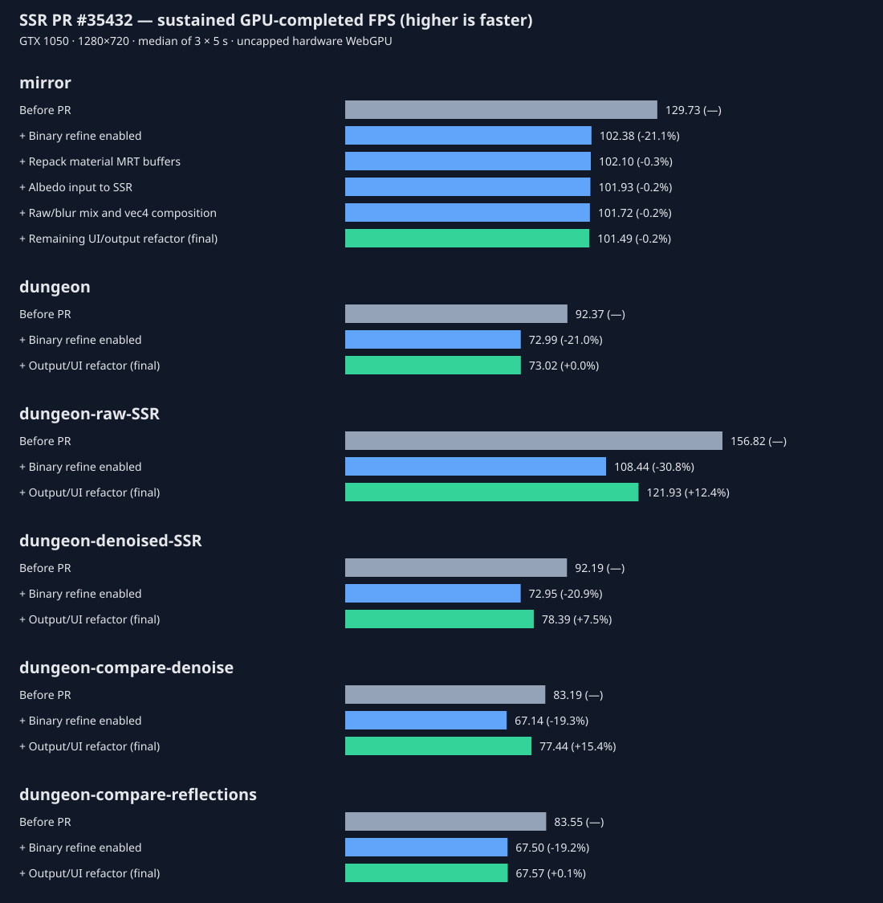

# SSR example profiling — PR #35432

[Original PR](https://github.com/mrdoob/three.js/pull/35432). Base: `29c99f4e170d01c2ecc47e44c48b29a6c57379dd`; head: `c85daef49196e28a687bf40c48a397defaf304be`.



**mirror: 129.73 → 101.49 FPS (-21.8%).** Binary refinement alone changes it to 102.38 FPS (-21.1%).

**dungeon: 92.37 → 73.02 FPS (-21.0%).** Binary refinement alone changes it to 72.99 FPS (-21.0%).

Binary refinement accounts for nearly all the default Beauty slowdown. In SSRNode it changes coarse hit tolerance and adds eight bisection iterations for eligible crossings, sampling depth and normals again to refine the intersection. This is additional shader work for improved hit accuracy. The other default changes are small compared with the refinement cost; sub-percent differences should not be assigned a causal performance benefit.

## mirror — default Beauty output

| Cumulative change | Median FPS | Trial range | Change vs previous | Change vs before |
|---|---:|---:|---:|---:|
| Before PR | 129.73 | 129.53–129.83 | — | +0.0% |
| + Binary refine enabled | 102.38 | 102.29–102.69 | -21.1% | -21.1% |
| + Repack material MRT buffers | 102.10 | 101.94–102.10 | -0.3% | -21.3% |
| + Albedo input to SSR | 101.93 | 101.86–101.96 | -0.2% | -21.4% |
| + Raw/blur mix and vec4 composition | 101.72 | 101.67–101.72 | -0.2% | -21.6% |
| + Remaining UI/output refactor (final) | 101.49 | 101.46–101.50 | -0.2% | -21.8% |

## dungeon — default Beauty output

| Cumulative change | Median FPS | Trial range | Change vs previous | Change vs before |
|---|---:|---:|---:|---:|
| Before PR | 92.37 | 92.35–92.41 | — | +0.0% |
| + Binary refine enabled | 72.99 | 72.88–73.05 | -21.0% | -21.0% |
| + Output/UI refactor (final) | 73.02 | 72.91–73.13 | +0.0% | -21.0% |

## dungeon-raw-SSR

| Cumulative change | Median FPS | Trial range | Change vs previous | Change vs before |
|---|---:|---:|---:|---:|
| Before PR | 156.82 | 156.71–156.85 | — | +0.0% |
| + Binary refine enabled | 108.44 | 108.10–108.58 | -30.8% | -30.8% |
| + Output/UI refactor (final) | 121.93 | 121.84–122.04 | +12.4% | -22.2% |

## dungeon-denoised-SSR

| Cumulative change | Median FPS | Trial range | Change vs previous | Change vs before |
|---|---:|---:|---:|---:|
| Before PR | 92.19 | 92.18–92.19 | — | +0.0% |
| + Binary refine enabled | 72.95 | 72.88–73.07 | -20.9% | -20.9% |
| + Output/UI refactor (final) | 78.39 | 78.28–78.46 | +7.5% | -15.0% |

## dungeon-compare-denoise

| Cumulative change | Median FPS | Trial range | Change vs previous | Change vs before |
|---|---:|---:|---:|---:|
| Before PR | 83.19 | 83.04–83.20 | — | +0.0% |
| + Binary refine enabled | 67.14 | 67.01–67.27 | -19.3% | -19.3% |
| + Output/UI refactor (final) | 77.44 | 77.33–77.47 | +15.4% | -6.9% |

## dungeon-compare-reflections

| Cumulative change | Median FPS | Trial range | Change vs previous | Change vs before |
|---|---:|---:|---:|---:|
| Before PR | 83.55 | 83.54–83.55 | — | +0.0% |
| + Binary refine enabled | 67.50 | 67.47–67.61 | -19.2% | -19.2% |
| + Output/UI refactor (final) | 67.57 | 67.46–67.57 | +0.1% | -19.1% |

## Method and interpretation

- Hardware: physical NVIDIA GeForce GTX 1050 (Pascal, 2 GB), driver 560.94 (32.0.15.6094). Every variant checks the actual WebGPU device adapter: NVIDIA, non-fallback. Browser: Chrome/157.0.8103.39, headless, default WebGPU backend. Raw GPU diagnostics are in gpu-system.json in the swarm artifacts.
- Fixed 1280×720 canvas, device pixel ratio 1, initial example camera, loaded models/environment, default parameters. Controls settle during warmup. No animation example is compared: it is new and has no before version.
- Sequential variants; three-second minimum warmup, then three trials of at least five seconds. Each trial counts complete batches of eight full frames, waits for WebGPU queue completion, and divides completed frames by total wall time. GPU queues are drained before each trial and before switching variants. No individual frame timings are taken.
- Vsync and frame limits are disabled with Chromium flags. The harness drives rendering directly rather than waiting for requestAnimationFrame. It reproduces Three.js Animation frame bookkeeping (node frame update, info reset and Inspector begin/finish), so scene, SSR, blur/denoising and AA passes execute for every counted frame. Merely calling pipeline.render repeatedly without advancing the node frame would incorrectly reuse pass results.
- This measures sustained rendering throughput including CPU submission and GPU completion, rather than visible monitor presentation rate or a GPU-only shader time. Batching bounds queue depth and amortizes completion waits. Inspector remains attached for both versions. Screenshots are outside timed regions.
- Both endpoints use the same head library source: this PR changes examples, metadata, screenshots and an e2e exception name, with no core or addon implementation changes. Build imports are served as source re-exports without generating repository-root build files. Original HTML is read from the pinned commits; incremental variants are generated in memory.
- Steps are cumulative in the listed order, not independent additive costs. Small changes near trial variation should be treated as noise. Shader compilation, loading, initial shadow rendering, PMREM generation and initial temporal convergence are excluded by warmup. Results are specific to this GPU, viewport and stationary initial camera.

## What actually changed

The only changed default SSR option in either existing example is binary refinement: false → true. Quality stays 0.5 (mirror) and 0.25 (dungeon); max distance stays 1 and 0.4; thickness stays 0.03 and 0.1; mirror blur quality stays 1. Existing material roughness and lighting defaults remain. The dungeon already used TRAA before the PR; the new TRAA toggle defaults to true, so it does not add a pass to default Beauty.

The mirror also replaces its normal + metal/roughness MRT layout with normal/roughness + albedo/metalness, switches from metalness/roughness to materialMetalness/materialRoughness, supplies albedo to SSR, and changes final composition to an explicit raw/blur mix. Those are measured separately above. Both layouts use two unsigned-byte auxiliary attachments; the repacking does not remove an attachment.

Dungeon raw SSR, denoised SSR and denoise comparison outputs now bypass TRAA/sharpen, which changes their rendering cost. The reflection comparison still applies temporal postprocessing to both sides. These views have their own before → binary-refine → final series, so their change is not confused with default Beauty.

Renames, titles, descriptions, slider ranges/labels, folder placement, added pointer-release handlers and the e2e exception rename do not change default GPU rendering work. The final steps include their aggregate CPU/UI effect rather than assigning unsupported FPS gains to individual labels. Blur and denoise toggles select via shader mix; disabling one does not establish that its producer pass stops executing. No off-toggle speedup is claimed.

## Reproduce and validation

From the repository root at the profiled head or this report branch:

```powershell
npm.cmd ci
node reports/ssr-35432/profile.mjs
node reports/ssr-35432/report.mjs
```

Optional environment variables: CHROME_PATH, SWARM_ARTIFACTS (output directory), ONLY (substring selecting example/step). Use a physical NVIDIA GPU or adapt the explicit hardware assertion to another physical adapter. The server and browser shut down on completion or failure. Do not run other GPU workloads during measurement.

Validation: npm test passed: lint-core, 1,982 core tests (one TODO), 147 addon tests; zero failed tests. The addon runner emitted a resource 404 despite passing all tests. node --check passed for the harness. No typecheck script exists. Hardware WebGPU rendering was exercised for every measured variant; screenshots and per-trial frame counts/durations are preserved in the swarm artifacts.
