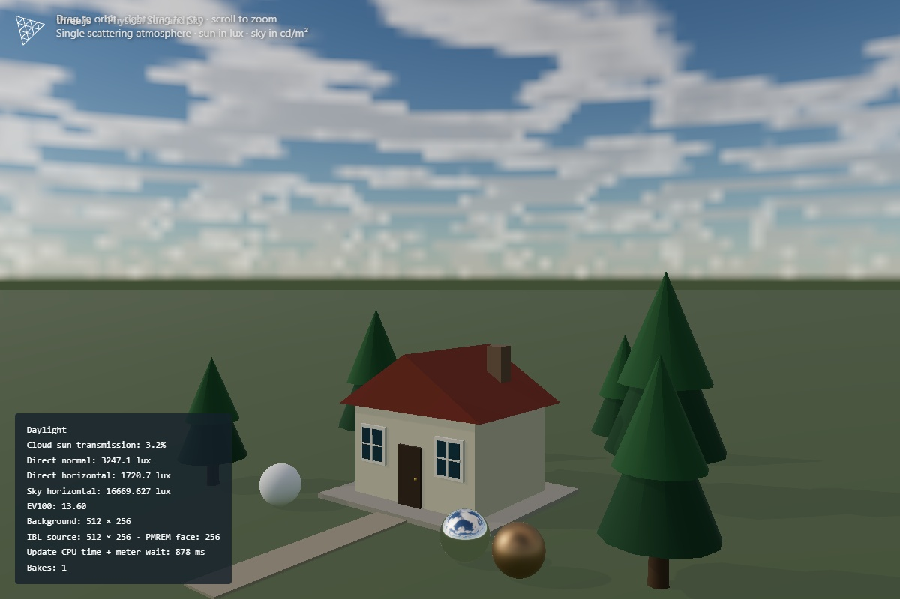
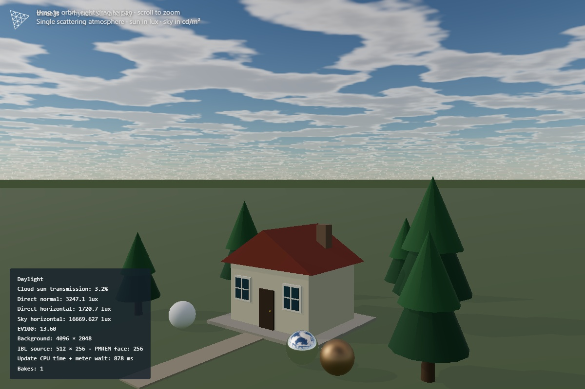
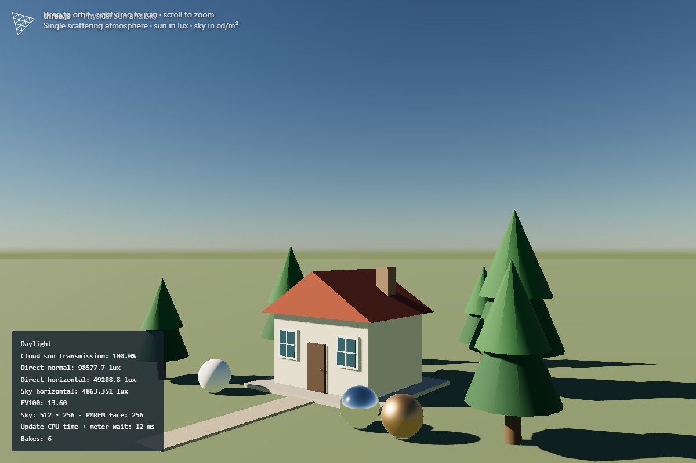
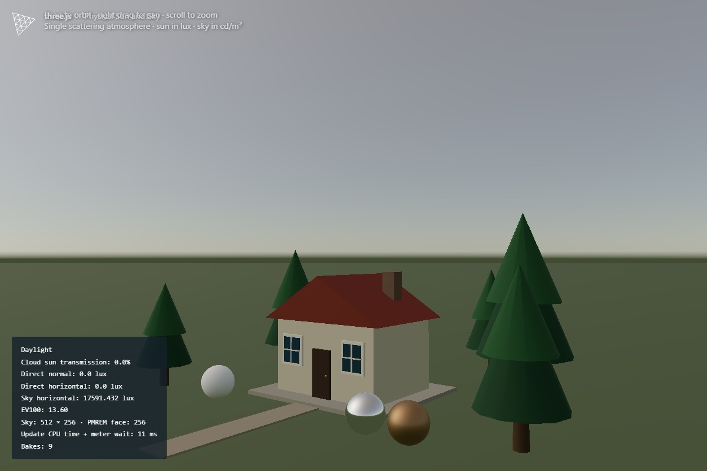
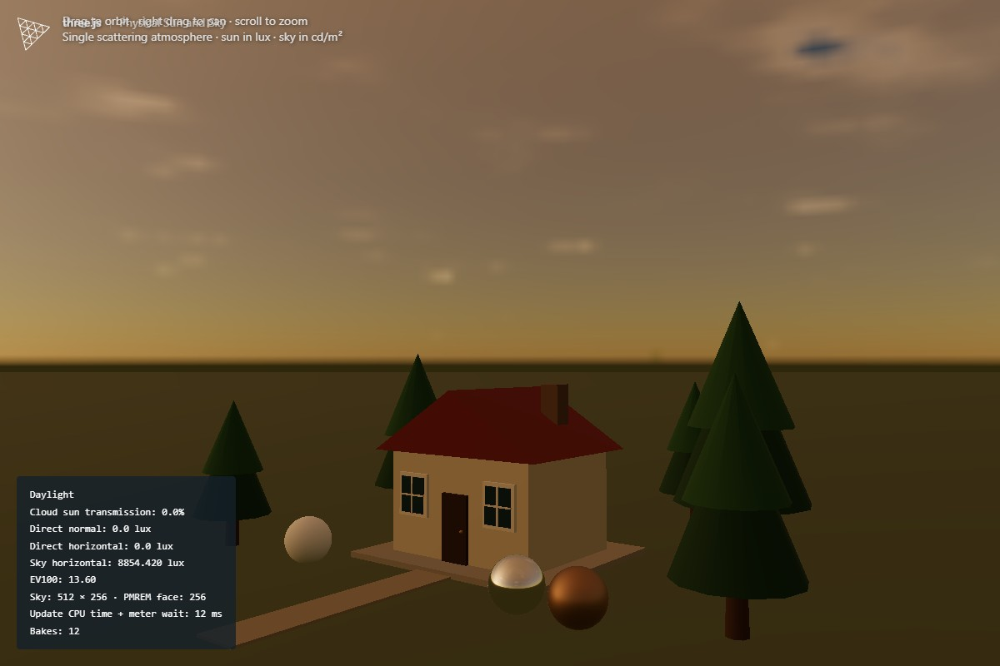
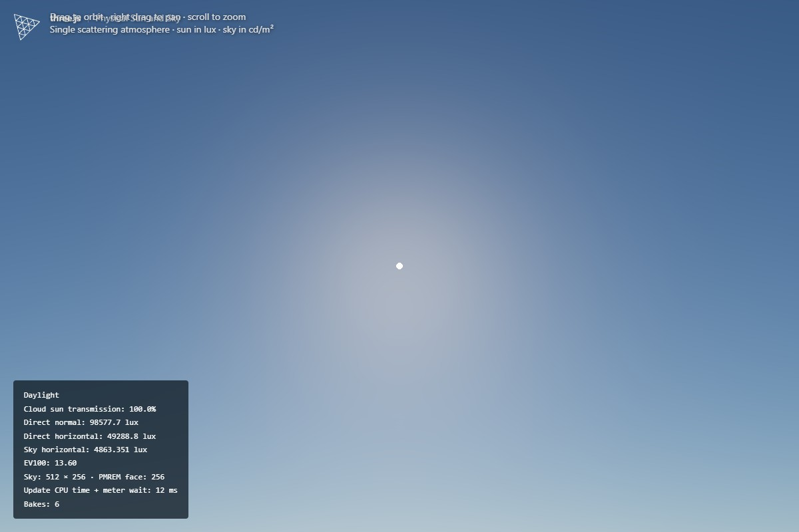
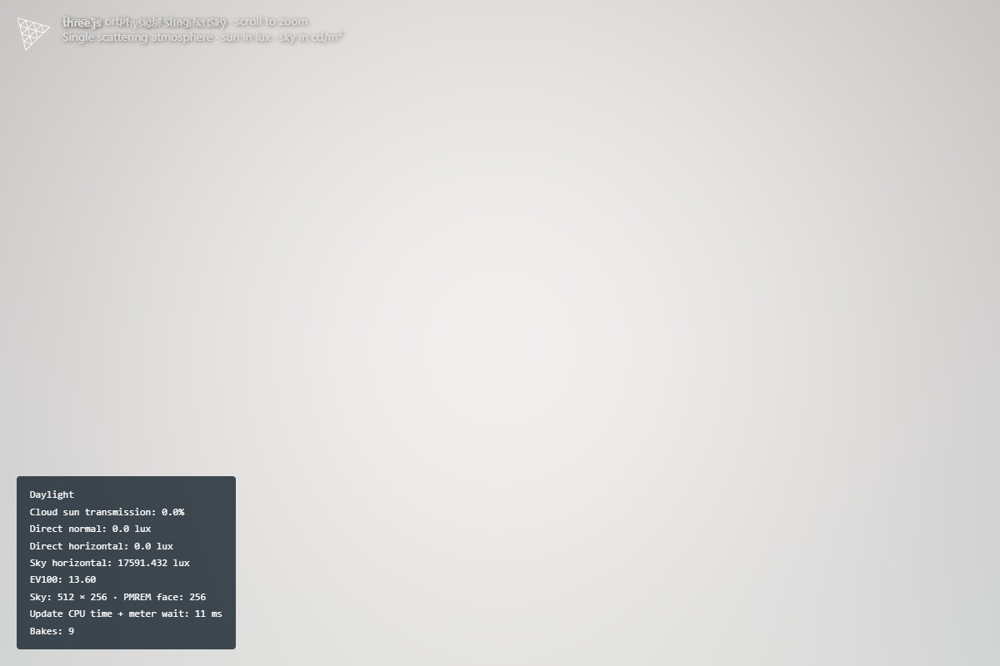

# Static clouds in the physical sun-sky example

The existing `webgpu_sky.html` example now composites a static spherical thin cloud layer into the atmosphere bake. `CloudLayerNode` uses five-octave MaterialX noise with coverage, altitude (metres), density (vertical optical depth), positive feature size (metres) and static arrangement offset controls. Coverage is an artistic threshold control rather than an exact covered-area fraction. The layer is clamped above the observer.

Cloud radiance uses the same atmosphere model's solar irradiance at cloud altitude, broad dual-lobe scattering, and approximate ambient/base lighting. This is an artistic thin-layer approximation, not volumetric transport or a multiple-scattering atmosphere model. Distant cloud footprints flatten toward the horizon.

The solar disc stays outside the sky/IBL input. A 1×1 GPU pass evaluates the same cloud density field in the sun direction. The meter carries its unscaled transmittance in alpha; the ground shader samples the same GPU result. The existing asynchronous meter readback then updates the directional light, CSM light, disc transmittance, exposure and readout together. There is no extra CPU readback barrier. Bake failure releases the baking flag in `finally`.

Clouds, ground and PMREM rebuild only when sun, atmosphere or cloud settings change. Orbiting and static frames reuse the textures. The scalar sunlight attenuation applies uniformly to this small scene; it is not a spatial cloud shadow map. Solar attenuation averages the finite source with 16 fixed samples; the filter scale can select a central-ray comparison. Static clouds have no animation, binary assets or new dependencies.

## Independent background and IBL resolution

The visible background previously sampled the same 512×256 equirectangular source used to generate IBL. It did not sample the filtered PMREM itself. At a normal camera field of view that left only a small number of texels across the screen.

The background now uses a separate RGBA16F target, default **4096×2048**. In **Sky quality**, background widths are **512, 1024, 2048, 4096, 8192**; height is half the width. **IBL source width** independently offers **512, 1024, 2048, 4096**, default 512. The previous default is the minimum for both controls. Increasing IBL resolution improves lighting/reflection detail independently, and PMREM derives its face size from the IBL source using its existing minimum and power-of-two rules.

A background-only resolution change rebakes only the visible target, reusing the same atmosphere/cloud uniforms and ground lighting. It does not regenerate PMREM, read back the meter, or change direct lighting/exposure. Sun, cloud and atmosphere changes rebuild both targets. No procedural background work runs during unchanged frames. The display target alone uses 64 MiB at the 4096 default, or 256 MiB at 8192; the higher quality increases rebuild work but not PMREM resolution.

Before, 512×256:



After, 4096×2048, with identical 512×256 IBL and direct lighting:



## Reproduce

From the repository root after `npm ci`:

```sh
node test/benchmarks/sun-sky-clouds.js cloud-results
```

The harness uses a physical WebGPU adapter and rejects software adapters. It captures elevations 90°, 30°, 5°, −2° with coverage 0, 0.3, 0.7 and 1. Full cover uses density 10; other states use density 2. It also captures views looking directly at the clear and covered sun. It checks all five visible resolutions without additional lighting bakes or changes to the IBL target or sunlight, and captures matching resolution comparisons. Output includes screenshots and JSON validation/throughput data. There is no configured TypeScript typecheck in this JavaScript repository.

## Validation on Build001

Hardware: NVIDIA GeForce GTX 1050, WebGPU adapter vendor `nvidia`, architecture `pascal`. Tests also ran against the unchanged checked-in build files used by raw.githack.

- All 16 sky images contained finite radiance.
- Coverage zero matched the original atmosphere shader bit-for-bit across 524,288 half-float components.
- Density zero returned exactly unit transmission.
- Thick full coverage reduced solar transmission below 0.001 at positive elevations.
- Directional light intensity matched atmosphere illuminance × cloud transmission × storage scale in every state; CSM matched directional intensity.
- Thirty calls to the example's actual animation function caused no new bakes with unchanged settings.
- Build and core lint passed; changed addon/example/benchmark ESLint passed.
- Core unit tests: 1,957 passed, one todo. Addon unit tests: 107 passed. The addon suite logged one resource 404; it had no assertion failures.

Complete GPU-finished rebuild throughput with 50% cloud coverage and fixed 512×256 IBL source:

| Visible background | Completed updates | Duration | Updates/second |
| --- | --- | --- | --- |
| 512×256 | 358 | 5.0100 s | 71.46 |
| 4096×2048 (default) | 150 | 5.0114 s | 29.93 |
| 8192×4096 | 53 | 5.0205 s | 10.56 |

The separate clear/512 baseline completed 349 updates in 5.0004 s (69.79/s). Counts include both sky targets, meter, ground, PMREM, scene rendering and shadows, with three warmups and separate sequential runs lasting at least five seconds. Vsync/frame caps/software rasterization were disabled, and GPU queue completion was awaited for every counted update and before switching cases. These are rebuild updates, not steady-state render FPS; static frames reuse both baked textures. The 16-state lighting regression matrix deliberately uses a 512-wide background to retain the original workload. The resolution comparisons use the new full-size backgrounds.

## Screenshots

All captures use fixed manual exposure EV100 13.6 so changing cloud cover also reveals the lighting change.

Clear / overcast:




Golden hour:



Views toward the sun, clear / covered:





## Finite-source attenuation alternative

`CloudLayerNode.getFilteredTransmittanceNode( direction, angularRadius )` averages Beer-Lambert **transmittance**, rather than averaging density and exponentiating it. Sixteen fixed golden-angle samples use equal-solid-angle strata over a cone. A robust tangent frame supports a sun at the zenith. A radius of zero evaluates exactly the original central ray. A fixed pattern avoids introducing temporal sampling noise. The existing 1×1 target, meter readback, CSM light, ground and exposure all consume the same mean transmission.

In **Static clouds**, **sun filter (0 point, 1 physical)** controls the angular radius multiplier. One uses `atmosphere.sunRadius` (about 0.27°). The default eight deliberately widens the filter for this artistic cloud layer. Larger values suppress small cloud features but are less physically accurate and can differ from the visibly small sun disc. They do not change the sun disc geometry, object shadow softness, BRDF, or light class.

This is a third independent option: angular/spatial low-pass filtering before deriving a single scene-wide light intensity, with no temporal lag and no spatial shadow texture. It can reduce high-frequency fluctuations when cloud patterns move continuously across the source. It cannot prevent jumps caused by arbitrary changes of arrangement, density or coverage, and still illuminates the entire yard with one value. The physical solar radius may have only a subtle effect for kilometre-scale cloud features. For broad local cloud shadows, a world-space transmittance map remains the more complete solution.

The added cost is fifteen extra five-octave cloud density evaluations in the **one-pixel solar bake pass**, only when settings change. There is no added full-screen or per-material sampling, readback, render target or steady-state frame work. Actual GPU-completed bake cost must be measured rather than inferred from the tap count; this pass may be a very small part of the sky and PMREM workload.

Primary-source rationale:

- [Unreal Engine directional lights](https://dev.epicgames.com/documentation/en-us/unreal-engine/directional-lights-in-unreal-engine) expose a Source Angle, default 0.5357° (solar **diameter**). This supports treating solar visibility as finite-source integration; it does not establish this particular 16-tap implementation as an industry standard.
- [PBRT spherical emitter sampling](https://pbr-book.org/4ed/Shapes/Spheres) derives uniform sampling over a cone of directions subtended by an emitter. The implementation uses equal-solid-angle deterministic quadrature of this domain.
- [Unreal Engine volumetric clouds](https://dev.epicgames.com/documentation/en-us/unreal-engine/volumetric-cloud-component-in-unreal-engine) describe cloud shadow maps with configurable extent and resolution. [Unity HDRP volumetric clouds](https://github.com/Unity-Technologies/Graphics/blob/master/Packages/com.unity.render-pipelines.high-definition/Documentation~/volumetric-clouds-volume-override-reference.md) similarly expose shadow distance and resolution. These are stronger precedents for the separate spatial shadow-map alternative.
