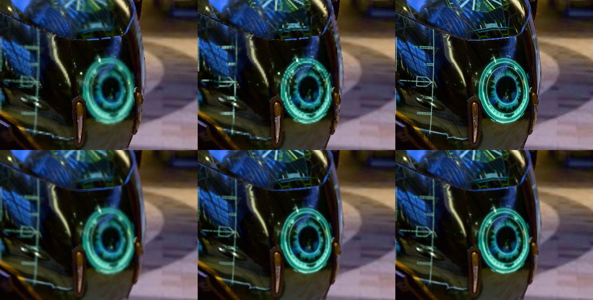

# Upscaler research on the DamagedHelmet example

Branch: `upscaler-research`, stacked on `upscaler-comparison` (`99f85e1a0065`, PR #162). Worktree: `/Users/bhouston/Coding/.worktrees/three.js-upscaler-research`. Original `joint-bilateral-upsample` and `upscaler-comparison` branches are unchanged.

The strongest all-round temporal mode is **`taau-mip-fast-responsive`**: at 3× it improves supersampled-reference helmet PSNR from 23.95 to **26.32 dB**, reduces mean frame cost from **1.85 to 1.40 ms** (24%), and reduces deterministic native-reference motion error from **12.717 to 9.049** (29%). The nine-tap **`taau-mip-responsive`** reaches **26.47 dB** at **1.62 ms**. For spatial reconstruction, **`joint-bilateral-mip-fused`** improves from 24.20 to **25.00 dB** at **1.15 ms** versus the original **1.19 ms**, with motion error falling from 7.836 to 6.772. These are same-session paired measurements, not comparisons against the previous report's absolute timings.

## Scope and experiment design

Three sub-agents implemented candidates in separate worktrees (`upscaler-taau-cost`, `upscaler-bilateral-research`, `upscaler-temporal-quality`). Only the parent ran GPU measurements, one browser/variant at a time. Originals remain selectable and unchanged in their implementation files.

Ten initial ideas:

1. **TAAU ping-pong/packed lock:** alternate two history targets instead of copying a full-resolution color target; store the opaque scene's lock in alpha rather than a separate attachment. Also repairs the original comparison's unwritten persistent lock.
2. **Five-tap TAAU:** use a cross rather than a nine-tap neighborhood for both color reconstruction and depth dilation.
3. **Sharper history:** normalized five-bilinear-tap Catmull–Rom history reconstruction.
4. **Depth-only bilateral:** omit the low-resolution normal attachment and four normal samples, retaining the full-resolution surface plane guide.
5. **Rational bilateral weights:** approximate the Gaussian depth weight with a reciprocal cubic polynomial.
6. **Wider bilateral:** nine-tap Gaussian support rather than four-tap bilinear support.
7. **Sharper bilateral:** square the four spatial tent weights, narrowing the reconstruction footprint without additional taps.
8. **Texture mip correction:** apply `-log2(upscaleFactor)` to implicit material texture gradients on the low-resolution pass. Also test an additional -1 level and apply the same correction to bilateral upsampling.
9. **Sample-aware temporal reconstruction:** narrow the current-color Gaussian from 2.29 to 4 and weight accumulation by the nearest jittered sample's distance. Test combined with the mip correction and cross neighborhood.
10. **Wide-jitter bilateral + TRAA:** span a whole low-resolution pixel, explicitly registering current color and current/previous depth to the unjittered output grid.

Additional follow-ups: tune temporal history response; register TAAU's previous jittered depth correctly; fuse spatial upsampling and/or RCAS sharpening into the final tone-map/display pass to eliminate full-resolution intermediates. Experimental nodes reset history on variant, factor, material and viewport changes.

## Literature and interpretation

- [AMD FSR2 integration and algorithm manual](https://gpuopen.com/manuals/fidelityfx_sdk/techniques/super-resolution-temporal/): material mip bias, jitter, reconstruction, history rectification and persistent locks. Its prescribed bias is `log2(render/display)-1`; our display-footprint bias omits the extra -1 unless explicitly selected. These experiments are not an FSR2 implementation.
- [Microsoft temporal antialiasing sample](https://learn.microsoft.com/en-us/samples/microsoft/xbox-gdk-samples/temporalantialiasing/): ping-pong history, reduced-tap Catmull–Rom filtering and variance clipping.
- [Kopf et al., Joint Bilateral Upsampling, SIGGRAPH 2007](https://johanneskopf.de/publications/jbu/): reconstruction with spatial support and high-resolution guides. The rational approximation and squared tents are local experiments, not claims of exact paper implementations.
- [Playdead temporal AA source](https://github.com/playdeadgames/temporal) and [Mikkel Gjoel's depth-aware upsampling explanation](https://pixelmager.github.io/depth_aware_upsampling/upsampling.html): neighborhood validation and the interaction between spatial reconstruction and temporal history acceptance.

The important distinction is that geometry guides cannot recreate material detail absent from low-resolution shading. The mip experiment changes which texture samples are shaded, before reconstruction; it is not post-process sharpening. It affects implicit material texture samples, including normal maps, but preserves explicit LOD and roughness-controlled environment sampling. `PassNode.contextNode` supplies texture gradients, so no engine-wide mip-bias API is needed. Existing texture transforms still apply.

## Measurement method

Same installed headless Chrome and real Apple M3 GPU through Metal as the original comparison. Adapter identity is checked before every run; software adapters are rejected. Viewport 1920×1080, device pixel ratio 1; primary input size 640×360 (3×).

- `mkpage.py <worktree>` creates an uncommitted `_cmp.html` with URL-hash parameters and test instrumentation.
- Quality: screenshots of the fixed camera and stationary helmet, against native and 3× supersampled native images downfiltered in linear light. PSNR is measured on displayed sRGB in the original helmet crop x=500–1229, y=170–999. Reference images are cached for follow-up sweeps. Images converge before capture.
- Throughput: vsync and frame limits disabled, warm up first, stop/drain before timing, render for five seconds, stop the render loop and drain before ending the interval. Count actual completed renders, with batched queue completion markers every 32 renders and a final drain. No individual frame timings. Every counted frame is GPU-completed by interval end.
- First performance screen uses one round with a 15-second idle pause after each variant. Final comparisons repeat baseline and winners; raw measurements remain alongside this report. Compare within the session, not with absolute times from the previous report.
- Motion: a deterministic fixed angular increment per rendered frame, with screenshots at identical frame/angle positions across variants. Compare the example's 4× displayed absolute error to an unjittered native reference. This metric includes reconstruction error and aliasing relative to native; it is not a standalone measure of ghosting or flicker. Its numbers are not directly comparable with the original wall-clock rotation sample positions.

## Limitations

One scene, camera, GPU and material set do not establish general superiority. PSNR favors some blur and does not fully describe shimmer, disocclusion or ghost trails. The static supersampled reference uses already tone-mapped samples downfiltered in linear light, matching the prior comparison; it is not a pre-tone-map radiance ground truth. The experimental TAAU packs a lock in alpha and therefore supports opaque color only. All original modes retain their prior behavior. Baseline TAAU's persistent lock is not updated in its original implementation; fixing this and removing bandwidth are coupled in the ping-pong ablation. Cooling pauses reduce thermal drift but do not guarantee fixed GPU clocks on the fanless MacBook Air.

## Results

### Recommended final modes at 3×

Bilateral costs come from the two rounds in `bench-final.log`. Responsive TAAU and its paired baseline come from two additional rounds in `bench-responsive.log`; that run's native baseline was stable at 1.012 and 1.025 ms. Each pair uses the same harness and cooling method. These family-specific comparisons are more useful than small absolute differences between sessions.

| Upsampler | Mean frame cost (range), ms | PSNR vs. supersampled | PSNR vs. native | Deterministic motion error ↓ |
| --- | --- | --- | --- | --- |
| `joint-bilateral` | 1.19 (1.16–1.23) | 24.20 dB | 24.89 dB | 7.836 |
| `joint-bilateral-fused` | 1.00 (0.97–1.03) | 24.20 dB | 24.88 dB | Not separately measured |
| **`joint-bilateral-mip-fused`** | **1.15 (1.12–1.19)** | **25.00 dB** | **25.62 dB** | **6.772** |
| `taau` | 1.85 (1.84–1.85) | 23.95 dB | 23.82 dB | 12.717 |
| **`taau-mip-fast-responsive`** | **1.40 (1.38–1.43)** | **26.32 dB** | **25.88 dB** | **9.049** |
| `taau-mip-responsive` | 1.62 (1.618–1.621) | 26.47 dB | 26.00 dB | 9.530 |

The final follow-up uses the existing motion-dependent accumulation and variance bounds more responsively: `currentFrameWeight` rises from 0.025 to 0.1, and `maxVelocityLength` falls from 128 to 16 input pixels. This is a paired tuning experiment with no added passes or texture samples. It improves the score in both static and moving tests on this scene. The five-tap responsive mode gives almost the nine-tap mode's static quality, at lower cost and lower native-reference motion error, so it is the main TAAU recommendation.

At 2× the responsive five-tap and nine-tap modes score **29.23 and 29.37 dB** against supersampling, versus **26.42 dB** for original TAAU. Their native-reference PSNR is 28.26 and 28.37 dB.

Bilateral still has lower native-reference motion error and lower cost than either temporal mode. The motion metric is not a flicker measurement; temporal stability should also be judged visually. The sharper temporal modes substantially improve the current implementation, rather than establishing universal superiority over spatial reconstruction.

### Combined modes before the response-weight follow-up

Frame cost is the mean of two five-second GPU-completed throughput measurements, with their ranges shown. The second round's native and baseline measurements were about 6–8% slower; the raw results are preserved rather than choosing a favorable minimum. PSNR uses exactly 320 rendered frames at a fixed Halton phase in this final check.

| Upsampler | Mean frame cost (range), ms | PSNR vs. supersampled | PSNR vs. native | Deterministic motion error ↓ |
| --- | --- | --- | --- | --- |
| Native (1×) | 1.01 (0.97–1.04) | 30.95 dB | — | — |
| `joint-bilateral` | 1.19 (1.16–1.23) | 24.20 dB | 24.89 dB | 7.836 |
| `joint-bilateral-fused` | 1.00 (0.97–1.03) | 24.20 dB | 24.88 dB | Not separately measured |
| `joint-bilateral-mip-fused` | 1.15 (1.12–1.19) | 25.00 dB | 25.62 dB | **6.772** |
| `taau` | 1.79 (1.72–1.86) | 23.95 dB | 23.82 dB | 12.717 |
| `taau-mip-fast-fused` | **1.40 (1.40–1.41)** | 25.86 dB | 25.48 dB | 11.331 |
| `taau-mip-fused` | 1.62 (1.59–1.65) | **26.22 dB** | **25.79 dB** | 12.677 |

- For spatial reconstruction, `joint-bilateral-mip-fused` is the useful quality/cost improvement. `joint-bilateral-fused` is the cheaper alternative that preserves the original quality. Mip-corrected bilateral reduces the deterministic native-reference motion error by about 14%.
- For temporal reconstruction, `taau-mip-fast-fused` is the more useful cost/motion tradeoff: about 22% lower mean cost, +1.91 dB static PSNR, and about 11% lower motion error than original TAAU. `taau-mip-fused` maximizes static quality (+2.27 dB) while remaining about 10% cheaper, but does not materially improve the motion error.
- Joint bilateral still gives the lower error against the native image in this motion test. The static temporal gain is not a claim of uniformly better animated images.
- The native scene is still cheap. Native performance and fused plain bilateral overlap; there is no substantial net rendering saving demonstrated on this scene.

### Cross-check at 2×

| Upsampler | PSNR vs. supersampled | PSNR vs. native |
| --- | --- | --- |
| `joint-bilateral` | 26.18 dB | 27.15 dB |
| `joint-bilateral-fused` | 26.17 dB | 27.15 dB |
| `joint-bilateral-mip-fused` | 27.15 dB | 27.89 dB |
| `taau` | 26.42 dB | 26.11 dB |
| `taau-mip-fast-fused` | 28.82 dB | 27.96 dB |
| `taau-mip-fused` | 29.24 dB | 28.28 dB |

### Ten-idea screen and ablations

These are preliminary single-round costs from `bench-screen.log`, not the two-round means above. Early static sweeps converged for a wall-clock interval; the final recommended-mode check instead fixes the render count and Halton phase. All results below exclude the failed initial shaders, which were repaired and remeasured.

| # | Trial | Static 3× PSNR vs. SSAA | Screen cost, ms | Finding |
| --- | --- | --- | --- | --- |
| 1 | TAAU ping-pong and packed persistent lock | 23.96 dB | 1.70 vs. original 1.73 | Small cost change; no quality improvement alone. Useful infrastructure for fusion. |
| 2 | Five-tap cross TAAU | 24.16 dB | 1.53 | Cheaper; also lower deterministic motion error (11.757 vs. 12.717). Used in fast combination. |
| 3 | Catmull–Rom history | 23.96 dB | 1.89 | No static benefit, as expected at zero reprojection displacement. Motion error improves modestly to 12.103; optional costly experiment. |
| 4 | Depth-only bilateral | 23.81 dB | 1.05 vs. original 1.13 | Slightly cheaper with a clear quality loss. Not a recommended quality mode. |
| 5 | Rational bilateral depth weights | 24.20 dB | 1.16 | Preserves quality but no M3 speed benefit; not an optimization win. |
| 6 | Nine-tap bilateral reconstruction | 24.05 dB | 1.71 | Slower and worse on this view. |
| 7 | Sharper bilateral tent | 24.23 dB | 1.14 | Tiny static gain, worse motion error (8.492 vs. 7.836). Not an overall win. |
| 8 | Material mip correction | Bilateral 25.00; TAAU 24.93 dB | Bilateral 1.31 before fusion | Large quality gain; extra texture bandwidth. Fusion recovers the cost. Extra -1 mip level adds no material benefit here. |
| 9 | Narrow/sample-aware TAAU | 24.75 dB | 1.72 | Improvement without measurable extra cost. Combined with mip correction reaches ~26.2 dB. |
| 10 | Low-resolution-pixel jitter bilateral + TRAA | 24.53 dB | 2.21 vs. original 2.24 | No clear static/cost benefit; modest motion change (9.113 vs. 9.246). With mip bias: 25.67 dB and 8.069 motion error, still behind spatial bilateral in motion. |

The fixed-frame ablation gives 24.58 dB for narrower reconstruction alone and 24.09 dB for distance weighting alone; their combination gave ~24.75 dB in the earlier sweep. A normalized five-tap Catmull–Rom history is optional, not part of the recommended fast/quality combinations. Previous-depth jitter registration is retained as a correctness option; it does not change the static score.

### Additional implementation findings

The original `SharpenNode` captures a fixed texture value during shader setup. Passing a ping-pong output directly to that node would therefore sharpen an older target on alternating frames. The new `researchSharpen()` samples the dynamic texture node directly and can be either baked into an RTT (for comparable unfused ablations) or fused into the final display pass. The original sharpening node is unchanged. Final temporal quality and motion measurements use the corrected dynamic reference.

The first spatial sweep hit a WGSL sampler declaration error in three new four-tap modes. Hoisting `textureSize()` ahead of a shared depth `gather()` caused sampler registration to occur in the wrong order. The fix preserves gather-first setup, and the failed images/timings were discarded. The final quality and timing logs contain no shader errors.

All candidates remain selectable for study, including unsuccessful ablations; the recommended modes are listed separately above. They are experiments rather than promises of improvement on arbitrary scenes. No original upsampler implementation was changed.

The final response-weight trials are in `psnr-responsive.log`, `psnr-responsive-2x.log`, `motion-responsive.log`, and `bench-responsive.log`.

Raw data and reproducibility: `psnr-*.log`, `bench-*.log`, `motion-*.log`, `results.json`, `compare.mjs`, `mkpage.py`, `verify-gui.mjs`, `summarize.py`, and `verify-commands.txt`.

## Runtime validation and branch

The pushed branch is [`bhouston/three.js:upscaler-research`](https://github.com/bhouston/three.js/tree/upscaler-research), commit `8d6c0b87e274`, based on `upscaler-comparison` at `99f85e1a0065`. [Compare the branches](https://github.com/bhouston/three.js/compare/upscaler-comparison...upscaler-research).

All 33 modes (six original and 27 experimental combinations/ablations) were selected through the real GUI in a single browser session. The check then reactivated temporal modes, resized 1920×1080 → 1280×720 → 1920×1080, changed scale through 1×, 2×, 3×, 3.5× and back to 3×, and changed the material to Metallic. No browser/shader/WebGPU validation errors occurred. See `gui.log`. Targeted ESLint and `git-dedup diff --check` passed. No repository-root `build/` or `docs/` files are in the commits. The temporary `_cmp.html` and generated local build changes were removed after verification; the research worktree is clean. Run `node utils/build/dev.js && node utils/server.js -p 8312` from the worktree to view the example again.

## What to try next beyond this comparison

The most useful further work concerns temporal stability and radiance-change detection. FSR2's luminance instability and shading-change checks are relevant to this helmet's moving specular reflections: a reprojected surface can remain geometrically valid while its radiance changes. A reactive history weight should distinguish that from stable texture detail. YCoCg/variance clipping and edge-aware motion selection are other literature-backed alternatives to the current simple RGB neighborhood bounds. Longer jitter cycles (FSR2 prescribes `ceil(8*factor^2)`, or 72 at 3×, versus the current fixed 32) deserve a separate convergence and stability study, not an assumed improvement.

For cost, a compute resolve could reuse low-resolution color/depth neighborhoods across a tile of output pixels; the current fragment shader repeats much of that work for adjacent output pixels. That requires a larger implementation and backend/performance study. For spatial reconstruction, material-aware guidance or shading demodulation could preserve information that depth and normals cannot supply, but would add buffers and need treatment of metallic/specular lighting. None of these unimplemented ideas is included in the measured gains.

## Inspecting the results

`montage-3x.png` contains 1:1 crops (x=900–1319, y=400–719). Top row, left to right: original joint bilateral, mip-corrected fused joint bilateral, native. Bottom row: original TAAU, responsive five-tap TAAU, responsive nine-tap TAAU. The full-frame PNGs are alongside this report. The code remains a comparison example: original modes plus all experimental ablations are available in the Upsampler dropdown, with a short explanation of the selected mode.

## Versioned evidence archive

This directory preserves the complete report, screenshots, reference images, raw logs and reproduction scripts in the PR branch. `SHA256SUMS` records every archived file. Logs from the initial failed shader experiments remain for historical context; the report identifies which results were discarded and remeasured.

The archived Node scripts resolve dependencies from this repository's `package.json`. Run the server from the repository root, then run these scripts from this directory. `mkpage.py` takes the checkout path as its argument. Historical absolute paths in the report and command transcript describe the original run; substitute your checkout path when reproducing it.

### Screenshot index

- [bilinear-beauty-3x.png](bilinear-beauty-3x.png)
- [joint-bilateral-beauty-2x.png](joint-bilateral-beauty-2x.png)
- [joint-bilateral-beauty-3x.png](joint-bilateral-beauty-3x.png)
- [joint-bilateral-depth-beauty-3x.png](joint-bilateral-depth-beauty-3x.png)
- [joint-bilateral-fused-beauty-2x.png](joint-bilateral-fused-beauty-2x.png)
- [joint-bilateral-fused-beauty-3x.png](joint-bilateral-fused-beauty-3x.png)
- [joint-bilateral-mip-beauty-3x.png](joint-bilateral-mip-beauty-3x.png)
- [joint-bilateral-mip-fused-beauty-2x.png](joint-bilateral-mip-fused-beauty-2x.png)
- [joint-bilateral-mip-fused-beauty-3x.png](joint-bilateral-mip-fused-beauty-3x.png)
- [joint-bilateral-mip-sharp-beauty-3x.png](joint-bilateral-mip-sharp-beauty-3x.png)
- [joint-bilateral-rational-beauty-3x.png](joint-bilateral-rational-beauty-3x.png)
- [joint-bilateral-sharp-beauty-3x.png](joint-bilateral-sharp-beauty-3x.png)
- [joint-bilateral-wide-beauty-3x.png](joint-bilateral-wide-beauty-3x.png)
- [joint-bilateral-wide-jitter-beauty-3x.png](joint-bilateral-wide-jitter-beauty-3x.png)
- [joint-bilateral-wide-jitter-mip-beauty-3x.png](joint-bilateral-wide-jitter-mip-beauty-3x.png)
- [montage-3x.png](montage-3x.png)
- [native-beauty.png](native-beauty.png)
- [supersampled-beauty.png](supersampled-beauty.png)
- [taau-beauty-2x.png](taau-beauty-2x.png)
- [taau-beauty-3x.png](taau-beauty-3x.png)
- [taau-catmull-beauty-3x.png](taau-catmull-beauty-3x.png)
- [taau-cross-beauty-3x.png](taau-cross-beauty-3x.png)
- [taau-distance-beauty-3x.png](taau-distance-beauty-3x.png)
- [taau-distance-weight-beauty-3x.png](taau-distance-weight-beauty-3x.png)
- [taau-mip-beauty-3x.png](taau-mip-beauty-3x.png)
- [taau-mip-catmull-beauty-3x.png](taau-mip-catmull-beauty-3x.png)
- [taau-mip-detail-beauty-3x.png](taau-mip-detail-beauty-3x.png)
- [taau-mip-distance-beauty-3x.png](taau-mip-distance-beauty-3x.png)
- [taau-mip-fast-beauty-3x.png](taau-mip-fast-beauty-3x.png)
- [taau-mip-fast-fused-beauty-2x.png](taau-mip-fast-fused-beauty-2x.png)
- [taau-mip-fast-fused-beauty-3x.png](taau-mip-fast-fused-beauty-3x.png)
- [taau-mip-fast-responsive-beauty-2x.png](taau-mip-fast-responsive-beauty-2x.png)
- [taau-mip-fast-responsive-beauty-3x.png](taau-mip-fast-responsive-beauty-3x.png)
- [taau-mip-fine-beauty-3x.png](taau-mip-fine-beauty-3x.png)
- [taau-mip-fused-beauty-2x.png](taau-mip-fused-beauty-2x.png)
- [taau-mip-fused-beauty-3x.png](taau-mip-fused-beauty-3x.png)
- [taau-mip-registered-beauty-3x.png](taau-mip-registered-beauty-3x.png)
- [taau-mip-responsive-beauty-2x.png](taau-mip-responsive-beauty-2x.png)
- [taau-mip-responsive-beauty-3x.png](taau-mip-responsive-beauty-3x.png)
- [taau-narrow-beauty-3x.png](taau-narrow-beauty-3x.png)
- [taau-pingpong-beauty-3x.png](taau-pingpong-beauty-3x.png)
