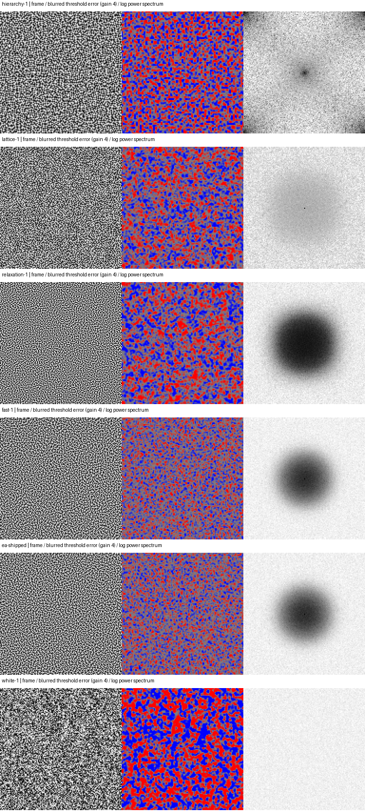
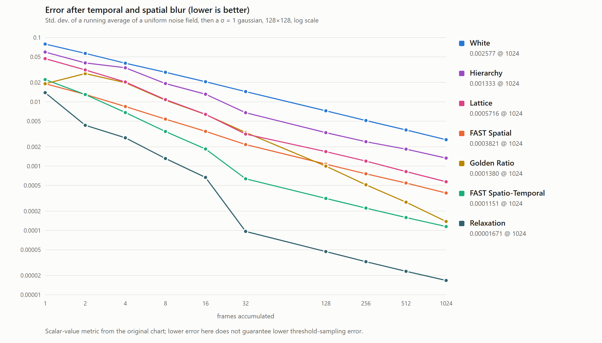

# Three faster noise construction experiments

Follow-up: [comparison with PR #117 and interpretation of the chart](RESEARCH-COMPARISON.md)
includes a common-protocol re-evaluation and explains why the raw-value winner
does not establish a better general graphics sampler.

These experiments are based on PR #115, commit `1e19ceee26`. Three sub-agents
independently implemented the methods after a literature review. All are
experimental alternatives; the existing FAST generator remains the default.

All three construct the volume much faster. None is an equivalent general
replacement for FAST. The lattice has the most balanced threshold results;
relaxation is particularly effective for directly filtered scalar values but
its spectral advantage does not survive thresholding. Hierarchy is extremely
cheap and can excel at dyadic thresholds, with visible structured correlations.

## Literature and choice of attempts

- [FAST, 2024](https://www.ea.com/news/spatio-temporal-sampling) optimizes error
  for chosen spatial and temporal filters. Its generality motivates using the
  original separate-mode optimizer as the reference, including an actual EMA.
- [Wolfe et al., Spatiotemporal Blue Noise Masks, 2022](https://arxiv.org/abs/2112.09629)
  explains why blue 3D spectra alone do not establish blue spatial slices and
  useful temporal behavior. We test space and time separately.
- [Ahmed and Wonka, 2020](https://abdallagafar.com/publications/zsampler/)
  uses scrambled hierarchical pixel ordering with low-discrepancy sampling.
  `hierarchy.js` explores a cheaper locally scrambled dyadic ordering plus
  digitally shifted van der Corput time samples. It is not ZSampler.
- [Belcour and Heitz, 2021 supplemental material](https://belcour.github.io/blog/supp/2021-sampling-bluenoise/)
  combines optimized spatial shifts and rank-1 temporal sampling, and evaluates
  blurred errors on test integrands. `lattice.js` explores that decomposition
  with only eight circular-phase local swap attempts per pixel, rather than
  training the shifts against integrands.
- [Georgiev and Fajardo, 2016](https://iliyan.com/publications/DitheredSampling/)
  motivates blue noise error distribution under nonlinear sampling.
  `relaxation.js` tries a separate spatial/temporal high-pass and histogram-CDF
  projection heuristic. It is an original experiment, not a reproduction of
  FAST, STBN, or that paper.

The implementations construct everything from the seed; no optimized input
texture, downloaded lookup table, API service, or offline preprocessing is used.
See each method's adjacent Markdown file for complexity and limitations.

## Timing protocol and hardware

Windows MediaPC, AMD Ryzen 7 5800H CPU, physical AMD Radeon Graphics (GCN-5).
Installed Chrome, Node v26.11.1. WebGPU reports vendor `amd`, architecture
`gcn-5`, `isFallbackAdapter: false`. Chrome's default D3D12 adapter request
returned null; explicitly choosing D3D11 exposes the physical adapter.
Software rasterization is disabled; no SwiftShader/lavapipe/llvmpipe is used.

Volume 128x128x32, seeds 1 and 2, scalar uniform output, quantized to 8-bit bin
centers for every quality comparison. FAST uses unchanged separate mode,
sigma=1, alpha=beta=0.1, weight=0.5 and all 10,000 iterations. Only separate is
benchmarked; product mode and other filter parameters are not covered.

Run implementations sequentially, with no tests running concurrently. The committed
measurements are an isolated repeat of the initial timing screen. Warm FAST with 100 iterations for each seed,
then run twice, waiting for final GPU readback before navigating away. Disable
vsync and frame caps. These are compute dispatches, not displayed animation
frames; completion is established by final mapped GPU output, not submission.
FAST timings include page navigation, initialization, shader compilation and
readback, excluding browser launch and base64 retrieval/file writing. Reloading
recreates pipelines, so this is end-to-end construction after an execution
warmup, not a pure warmed shader throughput measurement. Its own completed
iteration-loop log is approximately 61 seconds, close to the end-to-end wall time.

The alternatives run synchronously on the CPU in Node/V8, one full warmup and
three timed generations per seed, including allocation, initialization and all
optimization. Disk writes/PNG export are excluded. Runtime/backend differences
are intentional practical construction-cost comparisons; these ratios do not
measure same-backend kernel acceleration or rendered frame performance.

| Method | Completed generation time, all repetitions | Approximate construction speedup over FAST |
| --- | ---: | ---: |
| FAST separate 10,000 | 61.07–61.13 s | 1x |
| Hierarchy | 1.22–2.06 ms | 29,706–50,176x |
| Lattice | 91.62–111.02 ms | 550–667x |
| Relaxation | 97.89–198.11 ms | 308–625x |

These exceed the requested 10–100x construction target, with quality losses.
They are not equal-quality speedups. Full repetition times: [timings.json](results/timings.json).
Every repetition is retained; no outliers are discarded.

## Original ten metrics

Seed 1, exact definitions from `compare.py`. Lower is better for these metrics.
Spectra describe values themselves; they cannot establish error properties for
all functions of those values. `blN` is the spatial standard deviation after an
N-frame running mean and wrapped sigma=1 Gaussian. `ppN` omits the Gaussian.
The original EMA is unshifted periodic playback, matching `compare.py` exactly.

| Method | tmpLow | spLow | pp32 | pp256 | bl1 | bl4 | bl32 | bl256 | ema | ema+bl |
| --- | ---: | ---: | ---: | ---: | ---: | ---: | ---: | ---: | ---: | ---: |
| fast-1 | 0.153525 | 0.00306709 | 0.00399156 | 0.00140406 | 0.0252166 | 0.00791465 | 0.0005726 | 0.000203974 | 0.0237834 | 0.00227543 |
| ea-shipped | 0.154208 | 0.00304224 | 0.00397586 | 0.0014229 | 0.0252086 | 0.00776249 | 0.000582837 | 0.000210108 | 0.023825 | 0.00228294 |
| hierarchy-1 | 0.0634873 | 0.182425 | 0.00895034 | 0.00318665 | 0.0593569 | 0.0338556 | 0.00677224 | 0.00239736 | 0.0222223 | 0.00997727 |
| lattice-1 | 0.267029 | 0.212935 | 0.0132884 | 0.0047813 | 0.0469628 | 0.0203164 | 0.00315169 | 0.00119825 | 0.02903 | 0.00655995 |
| relaxation-1 | 0.000100802 | 0.00069074 | 0.000349458 | 0.000123641 | 0.0138857 | 0.00275767 | 9.65948e-05 | 3.26762e-05 | 0.016063 | 0.000784458 |
| white-1 | 1.00152 | 0.986349 | 0.0510081 | 0.0180758 | 0.083266 | 0.04124 | 0.014404 | 0.00495166 | 0.0685499 | 0.0192822 |

Both seeds are present at full precision in [scores.json](results/scores.json).
The shipped EA reference uses the atlas's **blue channel**: `make_atlas.py`
packs vector2 in RG and the separately optimized scalar in B. It closely
matches the newly generated FAST scalar reference. Seed-2 measurements preserve
the same broad quality ordering; only seed 1 receives the extended integrand
tests below.

## Nonlinear sampling errors

Use `1[x<t]` for t=0.1, 0.25, 0.5, 0.75, 0.9 (known integrals t), plus x²
and x⁴ (integrals 1/3 and 1/5). Quantize before evaluating each function.
Compute actual RMSE against the known integral, including bias, not just
standard deviation. Average squared error over all 32 starting phases and all
pixels. Frozen volume lookup wraps at 32 frames and applies the original
(-71,-37) spatial offset each cycle; no infinite procedural continuation or
fresh white samples are substituted. Box means cover 1,4,8,16,32,64 frames.
EMA uses alpha=0.1 over four cycles, averages the last cycle, and uses the same
shifted lookup for every method and all 32 independent start phases.

The following is RMS aggregated over all five thresholds after sigma=1 blur.
This prevents a favorable threshold from standing in for general quality.

| Method | 1 frame | 4 frames | 32 frames | EMA 0.1 |
| --- | ---: | ---: | ---: | ---: |
| fast-1 | 0.0504011 | 0.0208735 | 0.0052896 | 0.0077772 |
| ea-shipped | 0.0504712 | 0.0209033 | 0.0052813 | 0.0077785 |
| hierarchy-1 | 0.0718624 | 0.0280344 | 0.0087203 | 0.0120710 |
| lattice-1 | 0.0679197 | 0.0306290 | 0.0062762 | 0.0100247 |
| relaxation-1 | 0.0800620 | 0.0446758 | 0.0163051 | 0.0209639 |
| white-1 | 0.1132717 | 0.0565045 | 0.0199075 | 0.0258965 |

| Method | Threshold 0.5, 32 frames | x², 32 frames | x⁴, 32 frames |
| --- | ---: | ---: | ---: |
| fast-1 | 0.0052556 | 0.0015726 | 0.0018190 |
| ea-shipped | 0.0052380 | 0.0015641 | 0.0018125 |
| hierarchy-1 | 0.0027700 | 0.0085830 | 0.0085178 |
| lattice-1 | 0.0065165 | 0.0041433 | 0.0041012 |
| relaxation-1 | 0.0112026 | 0.0058411 | 0.0100770 |
| white-1 | 0.0247836 | 0.0146904 | 0.0131088 |

## Observed tradeoffs

- **Hierarchy:** construction is almost free and temporal stratification is
  exact in aligned dyadic blocks. Threshold 0.5 at 32 frames beats FAST here,
  while the five-threshold aggregate is 65% worse and scalar bl32 is about
  11.8x worse. Dyadic thresholds and aligned starts can flatter the method;
  random starts crossing a volume seam expose correlations. The spectrum and
  image have structure, not FAST's isotropic blue noise. Suitable for a very
  small construction budget when these correlations are acceptable.
- **Lattice:** the best balanced cheap attempt on this test suite. Threshold
  aggregate RMSE is 35% worse at one frame, 47% worse at four, 19% worse at 32,
  and 29% worse under EMA than FAST; all are substantially better than white.
  Scalar bl32 is 5.5x worse, x² error is 2.6x worse and x⁴ 2.3x worse. A finite
  depth cuts the irrational sequence at a temporal seam, and one shift tile
  couples every pixel's temporal sequence. It does not optimize the actual
  Gaussian/EMA loss. Further integrand-trained shift optimization is a useful
  direction, but is not established by this experiment.
- **Relaxation:** scalar bl32 is about 5.9x lower than FAST, EMA+blur about
  2.9x lower, with strongly suppressed scalar low frequencies. However, the
  five-threshold aggregate at 32 frames is 3.1x worse than FAST, and only 18%
  better than white. Histogram restoration and high-pass value shaping do not
  guarantee well-distributed indicator samples. x⁴ also loses substantially.
  This is promising for direct scalar dithering/averaging, not evidence of an
  equivalent general Monte Carlo sampler. Nyquist concentration is another
  visible tradeoff.

No rendered scene, moving geometry/disocclusion, vector2 distribution,
multi-dimensional integral, or other filter width was tested. The supplied
scalar atlas can exercise scalar reads in the existing texture lookup layout;
repeating its scalar across RGB does **not** create independently optimized
vector2 or vector3 samples. FAST is retained as the stronger general reference.
An already available alternative for higher quality is reducing FAST's step
count (the original README records its convergence tradeoff); that is separate
from these three new methods.

## Images

Rows: seed-1 hierarchy, lattice, relaxation, generated FAST, shipped FAST scalar,
white. Columns: first frame, sigma=1 blurred threshold-0.5 error (fixed gain 4),
and temporal-average spatial log power. Spectra use per-row 99.5-percentile
normalization to reveal shape, not absolute energy; consult numeric ratios for
power comparisons. These are CPU numerical plots, not GPU-rendered screenshots.



## Reproduce

```sh
npm ci
node utils/fastnoise/test-alternatives.js
node utils/fastnoise/generate-alternative.js lattice lattice.f32 1 lattice.png
# Each module also exports generate({ size, depth, seed }) for browser or Node.
# Optional CHROME_PATH selects installed Chrome. On this Windows GPU:
# PowerShell: $env:WEBGPU_BACKEND='d3d11'
node utils/fastnoise/benchmark-alternatives.js noise-results 10000
python -m pip install numpy pillow
python utils/fastnoise/score-alternatives.py noise-results
```

`generate-alternative.js` defaults to 128x128x32 and optionally exports the
256x4096 atlas used by FASTNoise. Left RGB repeat the generated scalar; right
RGB use the same scalar offset as `make_atlas.py`. Keep scalar/vector caveats
above in mind. Raw .f32 volumes remain swarm artifacts; their hashes are in
[hashes.json](results/hashes.json), with all measured results committed here.

## Validation

- Generator invariants pass: deterministic output, seeds differ, finite [0,1)
  values, dimensions, noncollapsed histogram, rejected invalid dimensions,
  periodic small cases, hierarchical dyadic temporal and spatial strata.
- ESLint passes for all added JavaScript; repository core lint passes.
- `npm test`: core suite has 1,980 passes, one TODO, two failures in
  `textureBarrier` and `workgroupArray.toAtomic`. Both reproduce exactly on the
  unchanged base source/test tree with this physical AMD D3D11 backend.
  The original 30-second runner wait also timed out once; allowing five minutes
  lets it finish and expose the two inherited failures.
- Addon suite run separately: 141 pass, zero failures. No typecheck script is
  defined in this JavaScript repository.
- Windows test launcher was adapted transiently to installed Chrome/D3D11,
  removing Linux Vulkan/lavapipe environment settings and disabling software
  rasterization. The tracked launcher is restored. Browser cleanup warnings
  and one addon 404 were emitted; no task server or browser remains running.
- Atlas export smoke test passes; after the reviewed Float32 upper-endpoint
  clamp, relaxation seed-1 output hashes identically to the scored volume.

## Convergence chart through 1,024 frames



This extends the [original PR chart](https://github.com/mrdoob/three.js/pull/35244)
at exactly 1, 2, 4, 8, 16, 32, 128, 256, 512 and 1,024 frames. It preserves
the original four curves and their conventions: fresh white noise (seed 0),
Golden Ratio rotating the first spatial slice, and the **left R channel** of
the shipped FAST atlases. That channel is a vector2 component, unlike the B
scalar reference used in the earlier integrand tables. The new methods use
seed 1 scalar outputs, quantized to the same 8-bit bin centers, and the same
32-frame volume playback and cycle offsets. No fresh generation or infinite
sequence continuation replaces their frozen volumes.

The metric is standard deviation of the phase-zero temporal mean after wrapped
sigma=1 Gaussian blur. It measures noise values, not general sampling error.
Relaxation is best on this metric, while the threshold and nonlinear tests
above explain why that does not establish it as the best Monte Carlo sampler.
The precise raw/unblurred and blurred values are in
[convergence.json](results/convergence.json); an editable
[SVG](results/alternatives-convergence.svg) is also included.

| Frames | White | FAST Spatial | FAST Spatio-Temporal | Golden Ratio | Hierarchy | Lattice | Relaxation |
| ---: | ---: | ---: | ---: | ---: | ---: | ---: | ---: |
| 1 | 0.0791102 | 0.0191279 | 0.0221912 | 0.0191279 | 0.0593569 | 0.0469628 | 0.0138857 |
| 2 | 0.0566971 | 0.0130400 | 0.0129899 | 0.0274788 | 0.0402634 | 0.0313190 | 0.0043209 |
| 4 | 0.0398381 | 0.0084527 | 0.0068197 | 0.0198493 | 0.0338556 | 0.0203164 | 0.0027577 |
| 8 | 0.0287830 | 0.0053819 | 0.0034544 | 0.0106018 | 0.0192471 | 0.0108246 | 0.0013156 |
| 16 | 0.0205297 | 0.0034740 | 0.0018485 | 0.0063535 | 0.0131375 | 0.0063878 | 0.0006676 |
| 32 | 0.0144189 | 0.0021662 | 0.0006355 | 0.0033397 | 0.0067722 | 0.0031517 | 0.0000966 |
| 128 | 0.0072490 | 0.0010743 | 0.0003149 | 0.0010004 | 0.0033180 | 0.0016814 | 0.0000469 |
| 256 | 0.0051203 | 0.0007599 | 0.0002226 | 0.0005128 | 0.0023974 | 0.0011982 | 0.0000327 |
| 512 | 0.0036536 | 0.0005464 | 0.0001589 | 0.0002753 | 0.0018372 | 0.0008238 | 0.0000232 |
| 1024 | 0.0025768 | 0.0003821 | 0.0001151 | 0.0001380 | 0.0013332 | 0.0005716 | 0.0000167 |

Reproduce from the repository root (create `noise-results` first):

```sh
node utils/fastnoise/generate-alternative.js hierarchy noise-results/hierarchy-1.f32 1
node utils/fastnoise/generate-alternative.js lattice noise-results/lattice-1.f32 1
node utils/fastnoise/generate-alternative.js relaxation noise-results/relaxation-1.f32 1
python utils/fastnoise/convergence.py examples/textures/noises/fast/gauss1-ema01-spatial.png examples/textures/noises/fast/gauss1-ema01-spatio-temporal.png noise-results > convergence.json
node utils/fastnoise/chart.js convergence.json alternatives-convergence.png
```

Set `CHROME_PATH` to an installed Chrome executable if needed. The PNG is a
2D SVG chart rasterization; no WebGL/WebGPU rendering or GPU performance
measurement is involved.
