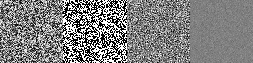
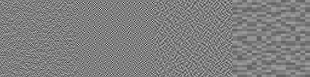
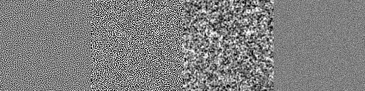
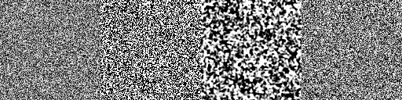

# Three faster generator experiments

Based on PR #115 (`1e19ceee264`), without changing the FAST reference or shipped
textures. All methods return the same z/y/x float32 volume and can be used with
the existing atlas/texture consumers. They are experimental alternatives, not
equal-quality replacements. Defaults are 128×128×32, seeds 1 and 2.

[Comparison with PR #116 and interpretation of the chart winner](PR116-COMPARISON.md)
includes new common-protocol nonlinear tests. The raw-value winner does not
generalize to graphics sampling; it loses to white noise on some integrands.

The next [four-approach research round](FRONTIER.md) targets broader metrics,
including independent-seed checks and extra-budget FAST controls. It records
both the promising seed-1 sweep and the seed-2 failure.

## Convergence chart

The [seven-method chart and numerical table](results/CONVERGENCE.md) compare
the three alternatives against White, Golden Ratio and the original shipped
FAST Spatial and FAST Spatio-Temporal textures at 1, 2, 4, 8, 16, 32, 128,
256, 512 and 1024 frames, using the base PR's uniform-field experiment.


## Research and choices

- [FAST, Donnelly et al., 2024](https://www.ea.com/news/spatio-temporal-sampling)
  derives a loss for filtered Heaviside integrands. This motivated checking
  thresholded samples as well as continuous values, and the cached threshold
  energy method below. We approximate that objective with short filters and a
  finite threshold grid, rather than implementing the original full loss.
- [Scalar Spatiotemporal Blue Noise Masks, Wolfe et al., 2022](https://arxiv.org/abs/2112.09629)
  shows why independent spatial blue noise and ordinary 3D blue noise do not
  automatically give the desired spatial/temporal behavior. Temporal
  stratification alone is therefore insufficient evidence of equivalent quality.
- [Wronski, 2020](https://bartwronski.com/2020/04/26/optimizing-blue-noise-dithering-backpropagation-through-fourier-transform-and-sorting/)
  explores spectrum shaping with a uniform histogram constraint. Our first
  method uses a cheap local filter and rank projection, not his differentiable
  Fourier optimization. The distinction matters particularly after thresholding.
- Bayer's 1973 recursively dispersed ordered dither and Owen's 1995 randomized
  nets suggest inexpensive hierarchical stratification. Our second method is a
  scrambled ordered-dither construction, not a claim of full Owen scrambling.
- [Blue Noise through Optimal Transport](https://geometry.caltech.edu/BlueNoise/bluenoise.html)
  addresses point distributions, so translating it into a progressive scalar
  space/time mask would require another optimization problem.
  [Neural generation](https://asztr.github.io/publications/ijcnn2022/ijcnn2022-preprint.pdf)
  is another promising direction, but needs trained weights/training and does
  not directly solve the temporal filter objective. Neither is implemented here.

Three sub-agents independently implemented the methods; the combined branch
adds evaluation, review, refinement and tests.

## Implementations

1. `methods/filter-rank.js`: 12 rounds of periodic binomial spatial high-pass
   and temporal high-pass, blended with the current values, followed by a
   65,536-bin rank projection. Exact global discrete histogram, approximate score ordering.
   O(iterations × voxels), no GPU, roughly 10 MiB of typed-array storage.
   Excellent continuous-value suppression, but nonlinear thresholds reintroduce
   substantial low-frequency noise. This is a specialized continuous-noise option.
2. `methods/hierarchy.js`: scrambled Bayer spatial ranks, animated by XOR with
   reversed temporal bits. Each frame has the full uniform histogram and each
   pixel visits every temporal stratum. No solve; O(voxels), about 2 MiB output
   plus a 64 KiB rank table. Restricted to power-of-two dimensions (see errors).
   Strong ordered motifs, dyadic resonance and threshold-dependent behavior.
3. `methods/local-energy.js`: greedy swaps with cached convolutions for 15
   binary thresholds, 32 attempts per voxel. Exact quadratic energy deltas avoid
   recomputing the full neighborhood for every candidate. Uses the sum of a
   3×3 binomial spatial-filter autocorrelation and a short temporal EMA
   autocorrelation (alpha .25, radius 4), not the reference sigma-1/alpha-.1
   full kernel. About 62 MiB potential cache plus output and small tables.
   The most balanced approximate substitute here. `thresholdCount: 0, passes: 4`
   retains the earlier, faster scalar-only experiment.

## Measurement protocol

Windows, Node 26.11.1, installed Chrome 156, physical NVIDIA GTX 1050. WebGPU
reports NVIDIA/Pascal and `isFallbackAdapter: false`; software rasterization is
disabled. The runner rejects missing, unknown or software adapters. Vsync and
frame limits are disabled. This is generation compute, so there are no rendered
frames: count complete volumes/iterations, not submitted GPU work.

FAST is warmed with 100 iterations, then measured sequentially at 10,000
iterations for each seed. Timings include page startup, kernel initialization,
all iterations, completed GPU readback and base64 transfer. Its own log reports
74.4/75.2 seconds inside the iteration/readback region, so startup does not
explain the large differences. The page is destroyed after each completed run.
CPU methods get a full-size warmup and run sequentially for at least five
seconds and two completed volumes per seed; divide total elapsed by completed
volumes. All required initialization and output allocation are included. This
compares end-to-end implementations on this machine, not equal hardware or
equal-quality algorithms. CPU methods may also be ported to compute later.

`results/timings.json` contains exact final timings and counts: FAST
74.53–75.34 s, filter/rank 0.110–0.113 s (660–687×), hierarchy
0.00113–0.00114 s (about 66,000×), and the final local-energy profile
5.390–5.402 s (13.8–14.0× faster than FAST).
The first two exceed the requested speed range at a significant quality cost.
The reference uses its full default budget; a reduced-iteration FAST run is
another useful speed/quality option, already tabulated in README.md, and these
speedups should not be interpreted as beating every reduced-budget reference.

## Quality results

Quantize all float32 output to the same 8-bit midpoint values as `compare.py`.
Use wrapped sigma-1 Gaussian blur (7 taps), running averages at 1/4/32/256
frames, and steady periodic EMA alpha .1. After each 32-frame cycle use the
same (71,37) spatial offset as `compare.py`. `results/quality.json` records all
metrics at full precision, both seeds, white controls and exploratory profiles.
Lower error is better. Ranges below cover both seeds.

| Method | Raw blur @1 | Raw blur @4 | Raw blur @32 | Raw EMA + blur |
| --- | ---: | ---: | ---: | ---: |
| FAST separate | .02522–.02554 | .00790–.00791 | .000573–.000581 | .002275–.002283 |
| Filter/rank | .00583–.00585 | .000949–.000952 | .0000560–.0000566 | .000327–.000328 |
| Hierarchy | .03678–.03722 | .02485–.02505 | .00665–.00669 | .00889–.00892 |
| Cached threshold energy | .02226–.02241 | .00783–.00802 | .00205–.00208 | .003147–.003159 |
| White control | .07896–.08011 | .04033–.04049 | .01437–.01465 | .01921–.01942 |

These raw-value results alone would incorrectly make filter/rank the clear
winner for stochastic rendering. Apply Heaviside integrands `sample < p` and
measure EMA-plus-blur RMSE against p, including bias:

| Method | p=.1 | p=.25 | p=.5 | p=.75 | p=.9 |
| --- | ---: | ---: | ---: | ---: | ---: |
| FAST separate | .00750–.00756 | .00751 | .00757–.00764 | .00753–.00754 | .00752–.00757 |
| Filter/rank | .02970–.03006 | .03383–.03426 | .01149–.01160 | .03390–.03420 | .02959–.03012 |
| Hierarchy | .01539–.01545 | .00476–.00477 | .00163–.00164 | .00476–.00477 | .01544–.01545 |
| Cached threshold energy | .01014–.01031 | .01094–.01104 | .00969–.00979 | .01086–.01106 | .01023–.01026 |
| White control | .02041–.02069 | .02879–.02925 | .03338 | .02898 | .02019–.02040 |

Cached threshold energy is roughly 27–47% worse than FAST on these threshold
EMA metrics, while substantially better than white noise. Its raw 32-frame
blurred error is still 3.5–3.6× worse than FAST. It meets the speed goal with
similar broad filtering behavior, not equal quality. Filter/rank is worse than
white for some thresholds. Hierarchy's exact cancellation at binary thresholds
(e.g. zero 4-frame error at p=.5) is a resonance, not general blue-noise quality;
its raw 32-frame error and visible ordered patterns remain poor.

Temporal/spatial low-frequency power (seed 1): FAST .1535/.00307;
filter/rank .0000161/.000817; hierarchy .0635/.0509;
cached threshold .0792/.0190; white 1.005/1.002. Again, continuous spectra are
not enough to predict the threshold results.

## Refinement experiments

Initial scalar cached swaps (4 passes) took .450 s but threshold-.5 EMA+blur
was .01758, versus FAST .00757. A threshold-cache extension improved this:

| Profile, seed 1 | Initial screen time | Raw EMA+blur | Threshold .5 | Threshold .1 |
| --- | ---: | ---: | ---: | ---: |
| Scalar, 4 passes | .450 s | .00362 | .01758 | .01782 |
| 7 thresholds, 4 passes | .583 s | .00589 | .01269 | .01419 |
| 15 thresholds, 4 passes | 1.384 s | .00524 | .01345 | .01294 |
| 15 thresholds, 12 passes | 2.444 s | .00392 | .01130 | .01141 |
| 7 thresholds, 16 passes | 1.512 s | .00461 | .01003 | .01340 |
| 7 thresholds, 32 passes | 2.316 s | .00431 | .00918 | .01316 |
| 15 thresholds, 32 passes | 4.478 s | .00316 | .00979 | .01031 |

These were single-run exploratory timings, not sustained benchmark claims.
The final profile is remeasured with full warmups and multiple completed
volumes in `timings.json`. Midpoint thresholds are `(c+.5)/count`; 15 includes
.1/.5/.9, whereas 7 does not include .1. Sparse objectives leave residual error
between thresholds. The final 15/32 profile favors a more balanced threshold
range over the faster 7-channel option. All exploratory quality rows are kept.

## Reproduce and inspect

From repository root after `npm ci`:

```sh
node utils/fastnoise/check-alternatives.js
node utils/fastnoise/benchmark-alternatives.js path/to/results
node utils/fastnoise/score-alternatives.js path/to/results
```

The benchmark starts and closes its own localhost:8732 server and browser.
Set `CHROME_PATH` to override the installed Windows Chrome default on another
platform. `--cpu-only` reuses existing timings.json and reruns the three CPU
methods. White controls are generated automatically. Output includes `.f32`,
timings.json, quality.json, and PNG panels. PNG panels left to right: first raw
slice, threshold .5, blurred threshold residual ×4, full-cycle raw residual ×8;
residuals centered at gray, clipped for display. Committed panels use seed 1.

FAST reference:



Filter/rank:


Hierarchy (visible ordered structure):



Cached threshold energy:



White control:



Serve the repository and open `utils/fastnoise/alternatives.html` to generate,
scrub frames, threshold and download all three methods. Modules are directly
importable in the browser or Node: `generate({size, depth, seed})`.

This evaluation measures constant integrands at five thresholds and a fixed
temporal sequence, not AO/volumetric scene quality, motion, disocclusion or all
temporal start phases. It does not establish unbiased rendered-image quality or
absence of anisotropy. No WebGL/WebGPU rendered-scene equivalence is claimed.

## Validation

`npm test`: 1,982 core passes (one TODO), 141 addon passes, zero failures,
including core lint. On Windows the existing unit launcher was temporarily
adapted to installed Chrome with software rasterization disabled and its Linux
lavapipe/Vulkan settings removed, then restored. A resource 404 and Windows
cleanup warnings did not fail tests. No typecheck script exists.

The Chrome browser preview generated all three volumes, scrubbed to frame 31
and toggled thresholding without page errors. Targeted ESLint covers all new
JS/HTML. `check-alternatives.js` verifies
determinism, bounds, invalid dimensions, different seeds, temporal strata,
histogram preservation and an independent full-convolution check that cached
threshold swaps lower the stated quadratic objective.

The seed-1 raw metrics were also cross-checked against the existing NumPy
`compare.py`; all ten printed metrics match the Node scorer. Used the machine's
existing Blender Python/NumPy, omitting only the unused Pillow import because
the inputs are float32 volumes, not PNGs. No repository Python code was changed.
