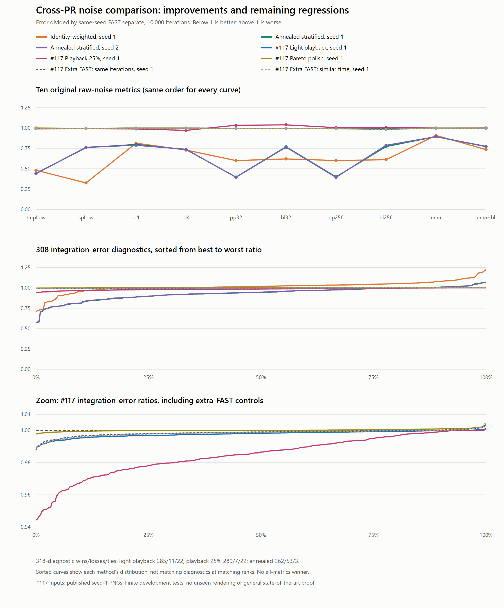

# Searching beyond FAST separate

We found meaningful improvements, but **no candidate exceeds FAST separate on
every audited quality metric**. The strongest new method, an annealed GPU
optimizer with hard temporal stratification, improves all ten original metrics
on both tested seeds. In the broader finite audit, it wins 262 measurements,
loses 53, and ties three on each seed. Its worst regression is approximately 7%.

This is a promising experimental generator, not a demonstrated new graphics
sampling state of the art. FAST remains the default and is unchanged.



## Latest PR #117 candidates on the same protocol

The chart now includes the most promising playback-aware schedules and the
guarded Pareto refinement from [PR #117](https://github.com/bhouston/three.js/pull/117),
pinned to `2a065526980261bcf5b129f07ddb12ff7eda1f91`. It also includes two
extra-FAST controls, because these refinements spend additional work after
constructing the original FAST texture. The third panel magnifies their small
integration-error differences; the upper panels retain the full comparison.

All rows below use **our unchanged 318 diagnostics**, against the identical
seed-1, 10,000-step FAST separate reference. Counts use absolute error tolerance
1e-12. Worst regression is the largest error ratio minus one; median change is
the median ratio minus one. These correlated quantities are descriptive.

| PR #117 profile | Wins / losses / ties | Worst regression | Median error change |
| --- | --- | --- | --- |
| Light playback, `light-seam-03` | 285 / 11 / 22 | +0.1373% | -0.1759% |
| Playback 25%, `seam-polish` | 289 / 7 / 22 | +3.8943% | -1.2995% |
| Pareto polish | 93 / 175 / 50 | +0.3713% | +0.0029% |
| Extra FAST, same 13,000 total iterations | 260 / 36 / 22 | +0.4204% | -0.1006% |
| Extra FAST, similar reported total time | 268 / 27 / 23 | +0.4510% | -0.1147% |

Light playback beats the same-iteration control on 254 diagnostics, loses 42,
and ties 22. Against the similar-time control, those counts are 223 / 73 / 22.
It offers a useful but small tradeoff; it does not dominate either control.
Its worst loss here is threshold .8 with spatial filtering after 64 frames.
The stronger playback weight wins more tests but loses five of the ten legacy
metrics, including the 3.89% regression in 32-frame filtered scalar error.
Pareto guarding on #117's own objective does not guarantee improvement across
this different suite.

Our annealed candidate still gives substantially larger gains across much of
this suite: in a direct seed-1 comparison it beats light playback on 263
diagnostics, loses 52 and ties three. Light playback has a smaller worst loss
relative to FAST. There is no unique ordering of these tradeoffs, and counting
wins alone discards their magnitude. The example therefore exposes these two
complementary experimental choices: **GPU Stratified Annealed** and
**PR117 Light Playback**, alongside six baseline controls. Both are precomputed
scalar PNGs, loaded on selection and cached; no optimization runs at runtime.
The other methods remain in the research code and analysis, outside the demo.

The light schedule is FAST 10,000 steps, then an original-loss restart of 2,000
steps, then a 1,000-step restart with playback weight .03. The stronger schedule
starts from FAST and adds 2,000 steps with playback weight .25. The controls use
the same restart boundaries with zero playback weight. These restarts reset
random keys and suppression, so they are not uninterrupted longer FAST runs.
The Pareto profile starts from FAST and applies four CPU refinement passes.
#117 reports total times including FAST input of approximately 117s, 119s and
83s, respectively, versus 75s baseline; its similar-time control costs 116s.
Those measurements use another GPU and are **not** a speed comparison with our
AMD measurements or a claim of faster construction.

This addition imports published seed-1 PNGs, validates their recorded hashes,
and reconstructs exact 8-bit midpoints before our quantize-first scorer. The
imported FAST reference reproduces **every** previously recorded baseline
result exactly, including bias statistics, validating the common normalization.
The pinned source manifest records the same original Float32 reference hash.
The decoded midpoint Float32 hashes differ from original prequantization hashes
by design; both are recorded in [import provenance](results/frontier/pr117-import.json).
The freshly regenerated annealed example asset also matches its historical
Float32 hash exactly.

Only seed-1 PNGs were published for this comparison. #117 reports seed-2 results
under its own **74-metric** suite, which cannot be substituted for seed-2 results
under our 318-metric suite. There is no new untouched scene, moving-camera,
disocclusion, multidimensional sampling or state-of-the-art evidence here.

To reproduce this extension after fetching the pinned PR #117 commit:

```sh
node utils/fastnoise/experiments/import-pr117.js /path/to/pr117-volumes
python utils/fastnoise/experiments/score-frontier.py /path/to/pr117-volumes utils/fastnoise/results/frontier/scores.json
python utils/fastnoise/experiments/audit-frontier.py utils/fastnoise/results/frontier/box-screen.json utils/fastnoise/results/frontier/scores.json utils/fastnoise/results/frontier/audit.json
node utils/fastnoise/experiments/chart-frontier.js utils/fastnoise/results/frontier/audit.json utils/fastnoise/results/frontier/frontier.png
```

The importer uses git-dedup to read the pinned sources without changing branches.
Its generation records preserve the original profile parameters and dependency
costs. The existing box screen is unchanged; the new profiles are fully audited.

## What was attempted

Three sub-agents independently implemented the CPU methods, followed by a GPU
search and independent numerical review. All from-scratch candidates construct
their values from the seed, without a stored optimized input texture.

1. **Threshold/mixed-energy refinement**, `experiments/threshold-refine.js`:
   cached quadratic updates for thresholds, identity and sine/cosine features,
   with separate and joint spatial/temporal filter terms. Both global swaps
   and swaps preserving each pixel's temporal distribution were tested. This
   improves subsets of the measurements but loses important spectral and
   transformed-function cases. Warm-starting from FAST was also tested and
   rejected; those experiments reuse optimized data and must include its cost.
2. **Stratification-preserving threshold optimization**,
   `experiments/stratified.js`: every pixel keeps one jittered sample in each
   temporal stratum while cached threshold energy selects temporal swaps.
   Larger budgets improve scalar spatial quality and central thresholds.
   Tail thresholds and spatial low-frequency power still regress. A helical
   cycle-boundary model did not remove those losses.
3. **Multifeature gradient/rank projection**, `experiments/multifeature.js`:
   gradients of several cosine-feature energies followed by uniform rank
   projection. The default uses the first three cosine basis functions
   `cos(pi*k*u)`, not just identity. More iterations and larger bases were
   screened. These attempts still have substantial nonlinear error losses.
4. **GPU objective and constraint experiments**, `experiments/gpu-features.js`
   and `run-gpu.js`: retain the existing GPU infrastructure but change the
   sample-distance loss, filter mixture, allowed pairings and acceptance rule.
   Identity weighting, Fourier weighting, sparse acceptance, temporal Latin
   hypercubes, a compact positive-semidefinite mixed filter, and annealing were
   tested. These produced the strongest improvements.

Individual CPU method notes preserve the agent's additional small screens and
limitations. The tables below use the common scorer, not incompatible local
measurements.

## Strongest candidate: annealed stratified GPU optimization

Initialization gives each pixel one independently jittered value in every
temporal stratum. A randomized permutation assigns those values to frames.
Unlike the original generator's within-slice swaps, an involutive pairing
exchanges two temporal positions **within the same pixel**. Thus the pixel's
entire sample multiset and its full-cycle mean are preserved exactly.

The distance term is `K(a,b) = -abs(a-b) - lambda*(a-b)^2`. The first term
retains FAST's continuous threshold-error objective; the second explicitly
balances raw-value integration error. A separate optional term,
`-gamma*(1-cos(2*pi*(a-b)))`, represents paired sine/cosine error. The strongest
profile uses lambda=.25 and gamma=0.

The filter is 80% of the original separate kernel plus 20% of a compact
space/time product term, restricted to radius two in x/y/time. This truncated
term is a heuristic, **not the full FAST product kernel**; truncation does not
guarantee a positive-semidefinite autocorrelation. A distinct valid
autocorrelation experiment uses the product of `[1,4,6,4,1]/16` along all three
axes, corresponding to the autocorrelation of `[1,2,1]/4`. That candidate is
also fully audited, and still fails the no-regression goal.

Swap suppression has a floor of two to reduce interacting parallel updates.
Individual favorable swap estimates do not imply global descent when many
pairs change concurrently. For the strongest profile, Metropolis acceptance
also permits uphill proposals with temperature .001, declining linearly to
zero at iteration 1,500, followed by 1,500 greedy iterations. This helps escape
the local optimum reached by the greedy constrained optimizer.

This combination improves spatial quality while retaining strong temporal
stratification. It directly addresses the earlier raw-only cancellation
failure: threshold error remains in the loss and distributional constraints
are retained, rather than merely reshaping scalar spectra.

The relationship to [FAST](https://arxiv.org/abs/2310.15364) is an experimental
extension of its filter/integrand-aware optimization, not a claim that weighted
feature losses or simulated annealing are new inventions. Its published
theory and rendering evidence remain broader than this study. The prior
[PR #117 comparison](RESEARCH-COMPARISON.md) explains why raw spectra alone are
insufficient and links the related sampling literature.

## Acceptance protocol

Use newly generated FAST separate at 10,000 iterations with the same seed as
each candidate. Seeds 1 and 2 are compared to their own references. The shipped
scalar FAST texture is an additional control, not a selectively chosen easier
reference. All volumes are 128x128x32, quantized to 8-bit bin centers.

The **screen** has 98 diagnostics: the original ten plus 22 functions at four
box windows (1,4,16,32), with sigma=1 spatial filtering. It can reject a
candidate, but cannot establish acceptance.

The **full audit** has 318 diagnostics:

- Ten original metrics: temporal/spatial low-frequency ratios, raw per-pixel
  errors at 32/256, spatially blurred errors at 1/4/32/256, EMA and EMA+blur.
- Twenty-two known-integral functions: identity, x², x⁴; thresholds
  .1/.25/.5/.75/.9/.17/.37/.63/.83/.2/.4/.6/.8; cosines at frequencies
  1/2/4/8; sines at frequencies 3/7.
- For each function, raw and sigma=1 blurred RMSE at 1/4/8/16/32/64 frames
  and alpha=.1 EMA. Thus 22 × 2 × 7 = 308 integration-error measurements.
- Actual RMSE against known integrals includes bias, over all pixels and all
  32 temporal start phases. Frozen-volume cycles shift by (-71,-37), matching
  the established consumer. EMA runs four cycles and measures the final one.

The new functions include thresholds between the fifteen-point cache grid and
frequencies outside the default projected-gradient basis. Once their results
influenced configuration selection, however, they became **development-suite
diagnostics**, not untouched held-out evidence. The annealing parameters were
fixed before their second-seed run. Two seeds are a confirmation screen, not
a statistical significance test or comprehensive generalization study.

Wins/losses use absolute tolerance 1e-12. Signed bias is retained as a diagnostic
but not incorrectly minimized as a signed quantity. The 318 counts are
correlated measurements, not 318 independent trials. No candidate clears even
the weaker requirement of no regressions with improvements elsewhere.

Strictly reducing every possible metric is not a general sampling guarantee:
for example, uniform single-sample variance is fixed by the marginal
distribution. Exact uniform histograms can create unavoidable ties. The
useful engineering target is no material losses across relevant tests plus
improvements where possible, followed by independent rendering validation.
These candidates still have real losses beyond those unavoidable ties.

## Results

| Candidate | Seed | Legacy metrics improved | Better / worse / tied, full 318 | Worst ratio |
| --- | ---: | ---: | ---: | ---: |
| Identity weighted, 1,000 GPU steps | 1 | 10/10 | 89 / 207 / 22 | 1.22413 |
| Greedy stratified hybrid, 3,000 GPU steps | 1 | 10/10 | 195 / 120 / 3 | 1.06563 |
| Greedy stratified hybrid, 3,000 GPU steps | 2 | 10/10 | 198 / 117 / 3 | 1.06874 |
| Valid mixed autocorrelation, 3,000 GPU steps | 1 | 10/10 | 218 / 97 / 3 | 1.07351 |
| CPU constrained threshold optimizer, 128 passes | 1 | 8/10 | 128 / 186 / 4 | 2.42088 |
| Annealed stratified hybrid, 3,000 GPU steps | 1 | 10/10 | 262 / 53 / 3 | 1.06768 |
| Annealed stratified hybrid, 3,000 GPU steps | 2 | 10/10 | 262 / 53 / 3 | 1.07032 |

The strong annealed profile improves **all ten original metrics** on both
seeds. Ratios below are candidate/reference, so lower than one is better:

| Metric | Seed 1 ratio | Seed 2 ratio |
| --- | ---: | ---: |
| tmpLow | 0.4429 | 0.4390 |
| spLow | 0.7584 | 0.7633 |
| bl1 | 0.7979 | 0.7880 |
| bl4 | 0.7353 | 0.7387 |
| pp32 | 0.3973 | 0.3951 |
| bl32 | 0.7689 | 0.7645 |
| pp256 | 0.3997 | 0.3941 |
| bl256 | 0.7721 | 0.7873 |
| ema | 0.8937 | 0.8933 |
| ema+bl | 0.7744 | 0.7710 |

The largest remaining failures are high-frequency transformed functions,
particularly single-frame blurred sin(14*pi*u): approximately 6.8% and 7.0%
worse on seeds 1 and 2. Some tail-threshold and short temporal-window errors
also regress. Unlike the earlier relaxation method, the raw-value gains do
not accompany multi-fold nonlinear losses, but these smaller losses still
invalidate an all-metrics claim.

The greedy stratified hybrid stops finding accepted swaps near 2,000
iterations. Its 3,000- and 10,000-iteration outputs have identical SHA-256
hashes. Spending more time on the same greedy rule does not repair its
regressions. Annealing increases the number of improved measurements from
195 to 262 (including the ten legacy metrics) on seed 1, while leaving a
worst-case regression around 7%. The hotter .01 schedule was screened but
was not an all-metrics winner either.

The broad filtering behavior is substantially better than the earlier three
cheap alternatives, but it is not a universal ordering of samplers. Spatial
spectra, scalar means, different integrands and different filters favor
different configurations. We did not change the reference or omit failed
diagnostics to turn these tradeoffs into a state-of-the-art claim.

## Cost, hardware and scope

Generation runs used physical AMD Radeon GCN-5 WebGPU/D3D11; the adapter
reported vendor `amd`, architecture `gcn-5`, fallback=false. Software
rasterization was disabled, vsync/frame caps disabled, and every volume was
read back completely before the next GPU run. These are compute dispatches,
not animation frames. No SwiftShader/lavapipe/llvmpipe was enabled.

Quality-screen times: full FAST approximately 61–62 seconds; identity-weighted
1,000-step variants approximately 7 seconds; strongest annealed 3,000-step
profiles approximately 31 seconds. The latter is roughly half the reference
construction time in this screen, not the original 10–100x speed target.
The 10,000-step greedy hybrid takes about 101 seconds and yields no additional
quality after its plateau. A Fourier/mixed 10,000-step profile took about
127 seconds and still failed the quality gate.

CPU analyses and agent work sometimes overlapped these quality screens. They
are exploratory wall times, **not isolated sustained performance benchmarks**.
Speedups are not acceptance criteria here; the quality gate already fails.
Warm-start profiles additionally require FAST's original construction cost
or reuse of a precomputed texture and are explicitly marked as such.

No AO/transparency/path-traced scenes, vector-valued sampling, motion,
disocclusion, alternative reconstruction filters or temporal resets were
validated. Consequently even an eventual clean finite audit would require
more evidence before an industry or state-of-the-art claim.

## Data and reproduction

- [All screened box diagnostics](results/frontier/box-screen.json)
- [Full 318-diagnostic measurements](results/frontier/scores.json)
- [Audited ratios, regressions and references](results/frontier/audit.json)
- GPU configuration manifests and completed-run logs in `results/frontier/`.
  They retain rejected profiles and exact experimental parameters.
- Full-size raw volumes remain swarm artifacts; input hashes are recorded by
  the full scorer and in `results/frontier/volume-hashes.json`.

The GPU runner serves an experimental specialization of `generator.html` in
memory; it checks expected source fragments before applying changes. The
default generator is never modified. An empty specialization is byte-identical
source. This is an exploratory harness, not a replacement public sampler API.

From repository root, after npm dependencies and NumPy/Pillow are installed:

```sh
node utils/fastnoise/experiments/test-experiments.js
node utils/fastnoise/experiments/run-gpu.js frontier utils/fastnoise/results/frontier/gpu-plan.json
node utils/fastnoise/experiments/run-gpu.js frontier utils/fastnoise/results/frontier/gpu-plan5.json
node utils/fastnoise/experiments/run-gpu.js frontier utils/fastnoise/results/frontier/gpu-plan6.json
node utils/fastnoise/experiments/run-gpu.js frontier utils/fastnoise/results/frontier/gpu-plan7.json
# Also run plans 2/3/4 to reproduce every GPU screen and the seed-2 reference.
node utils/fastnoise/experiments/run-cpu.js frontier utils/fastnoise/results/frontier/cpu-plan.json
python utils/fastnoise/experiments/screen-frontier.py frontier
python utils/fastnoise/experiments/score-frontier.py frontier full-scores.json
python utils/fastnoise/experiments/audit-frontier.py frontier/box-screen.json full-scores.json audit.json
node utils/fastnoise/experiments/chart-frontier.js audit.json frontier.png
```

`screen-frontier.py` defaults to all float volumes in the directory, or takes
explicit names after the directory to limit screening. The full scorer
can also take explicit names to limit expensive evaluation. A fresh output
JSON is required if scorer logic or functions change; its incremental cache
otherwise keys volume hashes, not scorer source. The committed final entries
were checked for the same complete 22-function coverage and current protocol.

Set CHROME_PATH for another installed Chrome executable. The current runner
explicitly selects Windows D3D11, matching this machine; other hardware needs
an appropriate physical backend and verification, not a software fallback.
Numerical plots use 2D SVG rasterization, not a GPU-rendered scene.

## Validation

- Latest example validation: all eight dropdown entries work on physical AMD
  GCN-5 WebGPU/D3D11, fallback=false, with software rasterization disabled.
  Tests exercise failed-load recovery and retry, lazy loading, cache reuse,
  stale-selection protection, Sphere and Uniform modes. GPU readback of both
  experimental atlases matches every sampled right-half texel **exactly** at
  frames 0, 31 and 32, including cycle shifting and midpoint decoding.
  `node utils/fastnoise/check-example.js /path/to/artifacts` reproduces this
  Windows hardware check. It saves canvas exports because this machine's
  headless compositor screenshots omit the WebGPU canvas despite valid output.
- The PR #117 reference import matches the entire existing baseline result,
  including bias terms; all imported PNG hashes match the pinned manifest.
  Only seed 1 was added to this common-protocol extension.
- The latest `npm test` run exits zero: 1,982 core passes, one TODO, and 141
  addon passes. Its WebGPU context creation warning means renderer tests
  internally bypassed execution again; the dedicated hardware example check
  above provides separate validation. A resource 404 and Windows process
  cleanup warnings remain. The tracked launcher was restored, and scoped lint
  passes for the example, baker, importer, chart and browser check. No typecheck
  script is defined and no root build outputs are committed.

- New experiment tests pass determinism, dimensions/range, input immutability,
  temporal multiset preservation, exact cached energy deltas on tiny wrapped
  grids, and source-specialization guards. Existing generator invariants pass.
- Every GPU Latin-hypercube pixel in the checked seed-1 output visits all 32
  strata. GPU workloads complete and produce valid finite volumes.
- Re-running the CPU manifest reproduces all six screened CPU volumes byte
  for byte, including the warm-start profile and its scalar atlas input.
  Both newly generated 10,000-step FAST references match the ten historical
  metrics at full precision, so the reference was not weakened for this search.
- The optimized scorer agrees exactly with the older scorer on full-size
  identity, threshold .37 and cosine-4 inputs across every mode/frame/statistic;
  moving Gaussian filtering before wrapped fetches is numerically equivalent.
- Repository core lint and scoped experimental JavaScript lint pass. No
  typecheck script is defined.
- `npm test` exits zero: 1,982 core passes, one TODO, 141 addon passes.
  **GPU renderer tests internally bypassed execution because their contexts
  were unavailable in that run**; those pass counts are not GPU renderer
  validation. Generator compute was separately verified on the physical
  adapter as above. The earlier inherited D3D11 barrier/atomic failures remain
  documented in ALTERNATIVES.md rather than being claimed fixed.
- The Windows launcher adaptation removed Linux Vulkan/lavapipe settings,
  used installed Chrome/D3D11, disabled software rasterization and increased
  the wait timeout transiently. The tracked launcher was restored. A resource
  404 and cleanup warnings were recorded; no root build outputs changed.
