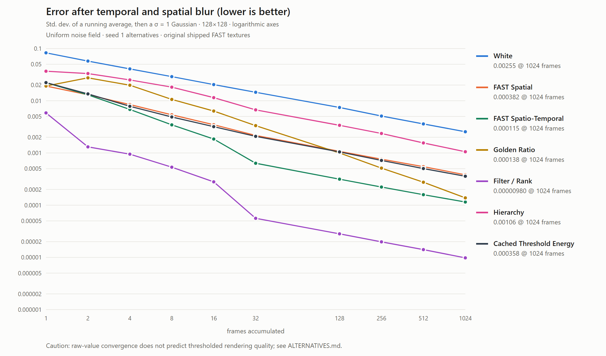

# Convergence comparison



Standard deviation of a running average of a uniform field, followed by the
base chart's wrapped sigma-1 Gaussian blur. Lower is better. Original shipped
FAST atlases, seed-1 alternatives, 8-bit midpoint quantization and the same
32-frame cycle shifts as convergence.py. Golden Ratio uses the original
spatial slice and uint32 Weyl offset. White uses independent seeded Mulberry32
samples; its realization differs from the original NumPy PCG64 curve.

This measures continuous values. Filter/rank is not a general rendering-quality
winner: nonlinear thresholding reverses its advantage in several tests. See
[the full threshold results](../ALTERNATIVES.md#quality-results).

| Frames | White | FAST Spatial | FAST Spatio-Temporal | Golden Ratio | Filter / Rank | Hierarchy | Cached Threshold Energy |
| --- | ---: | ---: | ---: | ---: | ---: | ---: | ---: |
| 1 | 0.082794 | 0.019128 | 0.022191 | 0.019128 | 0.0058550 | 0.036777 | 0.022264 |
| 2 | 0.057541 | 0.013040 | 0.012990 | 0.027479 | 0.0013085 | 0.033219 | 0.013529 |
| 4 | 0.040747 | 0.0084527 | 0.0068197 | 0.019849 | 0.00094872 | 0.025051 | 0.0078290 |
| 8 | 0.028980 | 0.0053819 | 0.0034544 | 0.010602 | 0.00053415 | 0.018222 | 0.0048921 |
| 16 | 0.020410 | 0.0034740 | 0.0018485 | 0.0063535 | 0.00027995 | 0.011475 | 0.0031897 |
| 32 | 0.014536 | 0.0021662 | 0.00063549 | 0.0033397 | 0.000056040 | 0.0066892 | 0.0020802 |
| 128 | 0.0074313 | 0.0010743 | 0.00031495 | 0.0010004 | 0.000028255 | 0.0033870 | 0.0010473 |
| 256 | 0.0050931 | 0.00075991 | 0.00022262 | 0.00051280 | 0.000019849 | 0.0023633 | 0.00071956 |
| 512 | 0.0035997 | 0.00054645 | 0.00015890 | 0.00027526 | 0.000014100 | 0.0015562 | 0.00050281 |
| 1024 | 0.0025502 | 0.00038210 | 0.00011506 | 0.00013798 | 0.0000098005 | 0.0010560 | 0.00035832 |

Reproduce from repository root:

```sh
node utils/fastnoise/convergence-alternatives.js
node utils/fastnoise/chart.js utils/fastnoise/results/convergence-alternatives.json utils/fastnoise/results/convergence-alternatives.png
```

Exact unrounded raw and blurred values and methodology metadata are in
[convergence-alternatives.json](convergence-alternatives.json). Editable vector
output is in [convergence-alternatives.svg](convergence-alternatives.svg).
