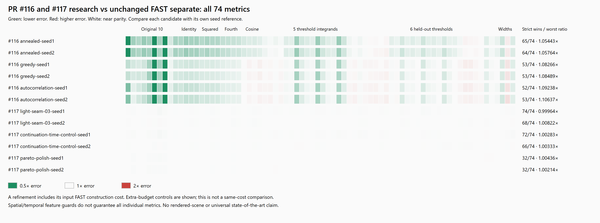

# PR #116 and #117 frozen-suite research results

Each candidate is compared with the unchanged FAST separate volume for the same seed.
Counts are deterministic point comparisons, not confidence statements. Tiny improvements
can be visually white; exact ratios are retained in frontier.json.

| Candidate | Better / 74 | Worse | Worst ratio | Total construction seconds |
| --- | ---: | ---: | ---: | ---: |
| #116 annealed-seed1 | 65 | 9 | 1.054430 | 37.487 |
| #116 annealed-seed2 | 64 | 10 | 1.057645 | 37.705 |
| #116 greedy-seed1 | 53 | 21 | 1.082664 | 37.561 |
| #116 greedy-seed2 | 53 | 21 | 1.084890 | 37.602 |
| #116 autocorrelation-seed1 | 52 | 22 | 1.092379 | 37.799 |
| #116 autocorrelation-seed2 | 53 | 21 | 1.106372 | 37.795 |
| #117 light-seam-03-seed1 | 74 | 0 | 0.999636 | 117.109 |
| #117 light-seam-03-seed2 | 68 | 6 | 1.008221 | 117.659 |
| #117 continuation-time-control-seed1 | 72 | 2 | 1.002830 | 116.065 |
| #117 continuation-time-control-seed2 | 66 | 8 | 1.003328 | 116.669 |
| #117 pareto-polish-seed1 | 32 | 38 | 1.004355 | 83.027 |
| #117 pareto-polish-seed2 | 32 | 34 | 1.002137 | 83.373 |

## Direct cross-PR comparisons

Each row pools the same 74 metrics for seeds 1 and 2 (148 point comparisons). Ratios divide #116 error by #117 error for the same metric and seed; below 1 favors #116. These are correlated measurements on two seeds, not independent trials or evidence of universal superiority. The worst ratio exposes regressions hidden by an aggregate. Construction costs above are unequal.

| #116 candidate | #117 comparison | #116 lower / 148 | Equal | #116 higher | Geometric mean ratio | Worst ratio |
| --- | --- | ---: | ---: | ---: | ---: | ---: |
| annealed | light-seam-03 | 129 | 0 | 19 | 0.869415 | 1.058539 |
| annealed | continuation-time-control | 129 | 0 | 19 | 0.869254 | 1.059406 |
| annealed | pareto-polish | 131 | 0 | 17 | 0.867971 | 1.056372 |
| greedy | light-seam-03 | 105 | 0 | 43 | 0.930129 | 1.086884 |
| greedy | continuation-time-control | 105 | 0 | 43 | 0.929957 | 1.086930 |
| greedy | pareto-polish | 106 | 0 | 42 | 0.928584 | 1.083585 |
| autocorrelation | light-seam-03 | 103 | 0 | 45 | 0.924676 | 1.106952 |
| autocorrelation | continuation-time-control | 103 | 0 | 45 | 0.924505 | 1.108215 |
| autocorrelation | pareto-polish | 105 | 0 | 43 | 0.923140 | 1.105040 |

### Direct comparison with the light-seam-03 candidate, by seed

Strict counts use exact floating-point comparisons with no tolerance; equal means an exactly equal measured error.

| #116 candidate | Seed | Lower / 74 | Equal | Higher | Worst #116 / light-seam-03 ratio |
| --- | ---: | ---: | ---: | ---: | ---: |
| annealed | 1 | 65 | 0 | 9 | 1.058539 |
| annealed | 2 | 64 | 0 | 10 | 1.058199 |
| greedy | 1 | 52 | 0 | 22 | 1.086884 |
| greedy | 2 | 53 | 0 | 21 | 1.085459 |
| autocorrelation | 1 | 52 | 0 | 22 | 1.096636 |
| autocorrelation | 2 | 51 | 0 | 23 | 1.106952 |

See [FRONTIER.md](../FRONTIER.md) for protocol, controls, limitations and interpretation.
[Exact scores and ratios](frontier.json) · [construction times and volume hashes](frontier-generation.json) · [SVG](cross-frontier-summary.svg).
