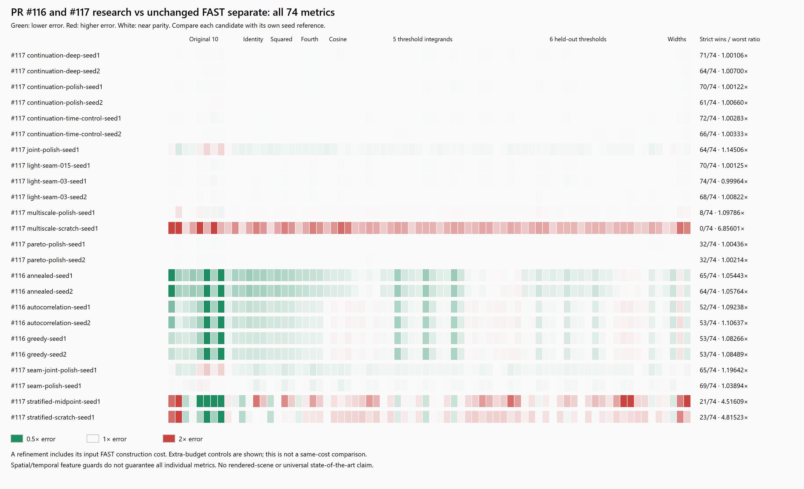

# PR #116 and #117 frozen-suite research results

Each candidate is compared with the unchanged FAST separate volume for the same seed.
Counts are deterministic point comparisons, not confidence statements. Tiny improvements
can be visually white; exact ratios are retained in frontier.json.

| Candidate | Better / 74 | Worse | Worst ratio | Total construction seconds |
| --- | ---: | ---: | ---: | ---: |
| #117 continuation-deep-seed1 | 71 | 3 | 1.001063 | 105.397 |
| #117 continuation-deep-seed2 | 64 | 10 | 1.007001 | 106.459 |
| #117 continuation-polish-seed1 | 70 | 4 | 1.001218 | 95.115 |
| #117 continuation-polish-seed2 | 61 | 13 | 1.006605 | 95.730 |
| #117 continuation-time-control-seed1 | 72 | 2 | 1.002830 | 116.065 |
| #117 continuation-time-control-seed2 | 66 | 8 | 1.003328 | 116.669 |
| #117 joint-polish-seed1 | 64 | 10 | 1.145060 | 119.977 |
| #117 light-seam-015-seed1 | 70 | 4 | 1.001246 | 117.143 |
| #117 light-seam-03-seed1 | 74 | 0 | 0.999636 | 117.109 |
| #117 light-seam-03-seed2 | 68 | 6 | 1.008221 | 117.659 |
| #117 multiscale-polish-seed1 | 8 | 66 | 1.097864 | 78.298 |
| #117 multiscale-scratch-seed1 | 0 | 74 | 6.856008 | 15.011 |
| #117 pareto-polish-seed1 | 32 | 38 | 1.004355 | 83.027 |
| #117 pareto-polish-seed2 | 32 | 34 | 1.002137 | 83.373 |
| #116 annealed-seed1 | 65 | 9 | 1.054430 | 37.487 |
| #116 annealed-seed2 | 64 | 10 | 1.057645 | 37.705 |
| #116 autocorrelation-seed1 | 52 | 22 | 1.092379 | 37.799 |
| #116 autocorrelation-seed2 | 53 | 21 | 1.106372 | 37.795 |
| #116 greedy-seed1 | 53 | 21 | 1.082664 | 37.561 |
| #116 greedy-seed2 | 53 | 21 | 1.084890 | 37.602 |
| #117 seam-joint-polish-seed1 | 65 | 9 | 1.196420 | 192.686 |
| #117 seam-polish-seed1 | 69 | 5 | 1.038943 | 118.620 |
| #117 stratified-midpoint-seed1 | 21 | 53 | 4.516086 | 8.538 |
| #117 stratified-scratch-seed1 | 23 | 51 | 4.815226 | 7.603 |

See [FRONTIER.md](../FRONTIER.md) for protocol, controls, limitations and interpretation.
[Exact scores and ratios](frontier.json) · [construction times and volume hashes](frontier-generation.json) · [SVG](frontier-summary.svg).
