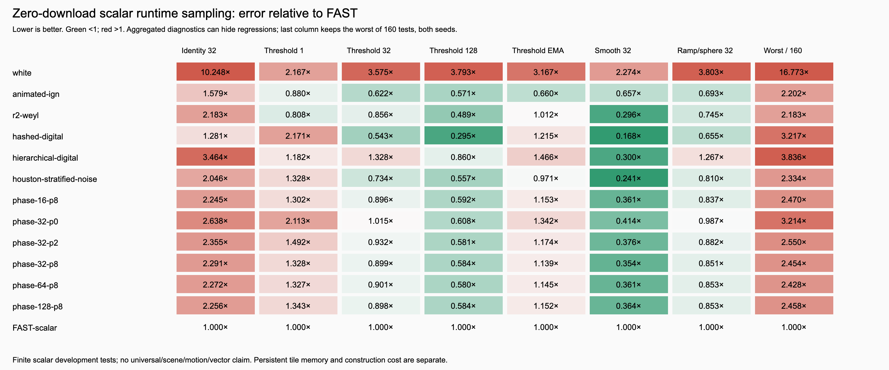

# Zero-download scalar sampling for Three.js

The new goal changes the recommendation: the 37-second annealed generator and
117-second FAST polishing schedule are unsuitable startup constructors. The
original image is 3,025,821 bytes and contains vector and scalar channels. A
procedural sampler or a tiny startup-generated phase tile removes that image
request entirely.

**My leading prototype is Houston Stratified Noise (`houston-stratified-noise`, HSN): zero texture bytes, no startup
solve, and useful threshold/EMA behavior.** It trades some single-frame quality
for much smaller construction/storage cost. A 32x32 generated phase tile is a
useful alternative when a texture-like integration is easier. Neither is a
demonstrated universal FAST replacement or new sampling state of the art.

## What “real-time blue noise” means

Blue noise describes a spatial error spectrum with suppressed low frequencies
and broadly distributed high-frequency energy. Real-time rendering commonly
samples a precomputed optimized mask; “real-time” describes its use, while its
construction can remain expensive. STBN additionally shapes temporal behavior.
The [NVIDIA STBN discussion](https://developer.nvidia.com/blog/rendering-in-real-time-with-spatiotemporal-blue-noise-textures-part-1/)
describes this distinction and its low-sample-count/low-dimensional use case.

Arithmetic low-discrepancy and ordered constructions supply another useful
tradeoff: immediate samples, temporal stratification and local coverage, with
directional patterns or correlations. Their benefits depend on the integrand
and reconstruction. A small filtered RMSE alone does not establish isotropic
blue noise. The [Ahmed–Wonka hierarchical ordering paper](https://doi.org/10.1145/3414685.3417881)
is particularly relevant to computing useful screen-space sample orderings
without a large optimized mask. The prototypes here are simpler experiments,
not implementations of that paper's complete sampler.

## Measured tradeoffs

Two seeds, 128x128 pixels, **159 actual successive frames**, all 32 start phases.
Use native float32 outputs, box windows 1/4/32/128 and EMA alpha .1 (96 burn-in,
32 measured frames). Fourteen known-integral functions give 140 raw/blurred
RMSE diagnostics: identity, u², u⁴, cosine, high-frequency sine, and nine
thresholds. Spatially varying ramp/sphere threshold images add 20 diagnostics.
Bias is retained. Spatial blur is wrapped sigma1, radius3. The FAST control is
the shipped scalar **B** channel, midpoint decoded with existing cycle shifts;
both seed controls use that same asset. This is a new runtime protocol, not
the earlier 74- or 318-measurement suite.

Actual physical-GPU streams were exported for six arithmetic samplers, two
phase tiles and FAST, both seeds: 18 streams / 46,891,008 samples. Their full
hashes match the CPU models exactly. Other tile-size/pass screens use the same
CPU arithmetic. Full data retain every attempted profile and every regression.

| Method | Startup / persistent sample data | Threshold blur: 1 frame / 32 frames / EMA, relative to FAST | Main tradeoff |
| --- | --- | --- | --- |
| White | none / 0 | 2.167 / 3.575 / 3.167 | Reference |
| Animated IGN, continuous translation | none / 0 | .880 / .622 / .660 | Strong directional spectra; long-running float-coordinate precision requires another strategy |
| Fixed-point R2 + Weyl | none / 0 | .808 / .856 / 1.012 | Minimal arithmetic, pronounced ordered spectral peaks |
| Hashed digital temporal sequence | none / 0 | 2.171 / .543 / 1.215 | Strong box-average stratification; spatially hash-like at one frame |
| Houston Stratified Noise (HSN): three-level tiled hierarchy + Weyl | none / 0 | 1.328 / .734 / .971 | Leading balanced code-only prototype; single-frame and some individual tests regress |
| Generated 16x16 phase tile, 8 passes | .461 ms warm / 1 KiB | 1.302 / .896 / 1.153 | Very small; 16-pixel repetition |
| Generated 32x32 phase tile, 8 passes | 1.778 ms warm / 4 KiB | 1.328 / .899 / 1.139 | Easy small-texture integration; 32-pixel repetition |
| Generated 64x64 phase tile, 8 passes | 7.272 ms warm / 16 KiB | 1.327 / .901 / 1.145 | Little measured quality gain over size32 |

Lower ratios are better. Threshold aggregates pool nine thresholds and both
seeds using RMS, with no bias removal. They summarize a subset; the complete
[summary table](SUMMARY.md) also exposes identity, nonlinear and varying-image
results and each candidate's worst individual ratio.



HSN's 32-frame ramp/sphere error is .810x FAST. Its worst
individual error is **2.334x FAST**, despite the favorable aggregate thresholds.
The phase32 method's threshold EMA error is 14% above FAST but 64% below white.
Thus useful benefits survive at tiny cost, with material quality tradeoffs.

Spectra explain why the simpler winners deserve care. The largest Fourier bin
contains about **24.6%** of averaged threshold-mask power for R2 and **17.8%**
for IGN, versus **0.014%** for FAST. HSN is about **0.044%**,
and phase32 about **0.49–0.68%**. This diagnostic is computed at threshold .5
over 32 frames after per-frame DC removal; it measures concentrated peaks,
not a universal quality score. A low raw-value variance can hide such structure.

## Recommendations

1. **First integration candidate to investigate: Houston Stratified Noise (HSN).**
   `procedural.js` exports matching CPU and WGSL functions. It scrambles local
   8x8 hierarchical ranks, gives each tile a hashed circular phase, and advances
   time with a fixed-point Weyl rotation. The WGSL module is about 411 gzip
   bytes in this standalone-source measurement, including shared helpers;
   a bundle and framework have their own overhead. This is a simple extension
   of the excluded hierarchy direction, with measured improvements over the
   deeper common-XOR variant, not a claim that its ingredients are novel.
2. **Simplest arithmetic option: fixed-point R2/Weyl.** It has zero sample
   storage and near-FAST aggregate threshold EMA here. Check directional
   patterns against target scenes before choosing it as a general default.
3. **Small generated-texture option: phase32, eight passes.** Generate one
   Float32Array, upload once, then use one phase fetch plus integer temporal
   rotation per sample. No image loader or asset download is involved. The
   generator uses about 96 KiB temporary neighbor storage plus a 17 KiB lookup;
   persistent phases are 4 KiB. The first measured module invocation took
   11.4 ms including JIT (size16); warm measurements are not cold/mobile
   promises. Larger tiles cost more without a useful win in this screen.
4. **Long per-pixel box accumulation:** hashed digital temporal sampling is a
   useful zero-asset control, especially at aligned powers of two. Its single-
   frame spatial error and EMA behavior justify separate evaluation for TAA.

The earlier filter/rank and PR116 relaxation constructors remain poor general
choices: their excellent filtered raw-value averages conceal threshold and
nonlinear losses. Cached threshold energy, annealing and FAST refinements have
startup costs far outside this goal. Cheap hierarchy remains worth considering
for ordered dithering; the deeper eight-level digital prototype in this round
lost to HSN on the main threshold/EMA diagnostics.

For a texture-based Three.js integration, phases can be uploaded directly:

```js
const phases = generate( { size: 32, seed: 1, passes: 8 } );
const noise = new THREE.DataTexture( phases, 32, 32, THREE.RedFormat, THREE.FloatType );
noise.minFilter = noise.magFilter = THREE.NearestFilter;
noise.needsUpdate = true;
```

Decode the phase directly; it is a float, not an 8-bit noise midpoint. Add
`float((frame * 2654435769u) >> 8u) / 16777216` and take the fractional part.
Integer arithmetic wraps at 2^32 frames, avoiding a growing float multiply.
The arithmetic prototypes likewise ship WGSL; a public TSL API and scene-level
default selection would be a follow-up integration decision.

## Multiple dimensions

Effects often need several values per pixel, such as a GGX direction pair or cone rotation and
elevation. Giving each dimension its own HSN seed decorrelates them spatially, but a **shared**
golden-ratio step moves every dimension by the same amount each frame. Over time a pixel's samples
then stay on one diagonal line in the unit square and stop converging, which showed up as grain in a
VXGI light map bake. The fix is a separate temporal step per dimension from the R2 (two values) or
R4 (four values) generalized golden ratio sequences; `procedural.js` exports `R2_STEPS` and
`R4_STEPS`. The spatial pattern is unchanged.

Per-pixel RMSE ×1e-3 over 14 known 2D integrals, 64×64 pixels (`multidim.py`):

| Method | Per pixel, 16 | Per pixel, 256 | Blurred, 1 frame | EMA, blurred |
| --- | ---: | ---: | ---: | ---: |
| White | 77.92 | 19.29 | 88.74 | 20.06 |
| Animated IGN, offset second dimension | 106.86 | 89.95 | 102.41 | 90.13 |
| HSN, shared golden step | 92.79 | 84.20 | 71.59 | 31.66 |
| **HSN, R2 steps** | **42.40** | **4.08** | 71.59 | **11.29** |
| HSN, R4 steps, worst pair | 45.57 | 12.08 | 71.59 | 12.27 |

Offset copies of IGN are not independent dimensions either: the second value is nearly a constant
shift of the first. Pairing the dimensions within each tile (bit-reversed ranks) was also tried; it
nearly doubled single-frame error, so it was dropped.

## Three.js adoption

[bhouston/three.js#121](https://github.com/bhouston/three.js/pull/121) uses HSN with R2 steps for
VXGI cone rotation and elevation and with R4 steps for SSR and its denoiser. On hardware WebGPU
against dev, the VXGI light map bake at 64 samples has 52% lower RMSE and 13% less texel grain, real-time
VXGI has 23% lower RMSE (with 7% more flicker), and SSR has 4–5% lower flicker, RMSE and bias. GTAO
and SSGI kept their existing schedules, which measured better there.

## Cost and evidence limits

Sequential hardware NVIDIA Pascal / Chrome156 runs disabled software fallback,
vsync and frame caps. Each profile warmed up for two seconds, then counted
GPU-completed 512x512 compute passes for at least five seconds. All measured
samplers, including FAST texture reads, achieved **690–741 million samples/s**.
These similar values include output writes, submissions and completion waits;
they establish practical scalar throughput in this harness, not a speed ranking
or full renderer performance. The test uses hot data and frame uniforms 0–7.
GPU sequence export/scoring happened after all timing runs. CPU construction
costs use warmed completed generations for at least five seconds per profile.

The analytic ramp/sphere fields add spatial variation, but are not ray-traced
scenes. Motion, disocclusion, rejection/clamping, vector dimensions, screen-size
changes, large coordinates, temporal resets, and full material/importance-
sampling pipelines remain untested. The 128-pixel wrapped test grid is a multiple
of the tile sizes; tile repetition and nonaligned crops need separate scene
checks. Two seeds and a finite development set do not establish generalization.
IGN's unbounded float translation needs additional long-duration validation.
No method in this round is established as an isotropic STBN or all-metric winner.

## Sources and reproduction

- [Jimenez, SIGGRAPH 2014 post-processing / IGN](https://www.iryoku.com/next-generation-post-processing-in-call-of-duty-advanced-warfare/)
- [Ahmed and Wonka, hierarchical screen-space ordering](https://doi.org/10.1145/3414685.3417881)
- [Heitz et al., low-discrepancy blue-noise screen-space error](https://perso.liris.cnrs.fr/david.coeurjolly/publication/heitz-19/)
- [STBN real-time use and dimensional limitations](https://developer.nvidia.com/blog/rendering-in-real-time-with-spatiotemporal-blue-noise-textures-part-1/)
- [FAST filter-aware objective](https://arxiv.org/abs/2310.15364)

```sh
node utils/fastnoise/runtime/generate-data.js runtime-data
node utils/fastnoise/runtime/gpu-benchmark.js --root . --output utils/fastnoise/runtime/gpu-results.json --sequences runtime-gpu-data
# Overlay exported GPU streams onto runtime-data before scoring.
python utils/fastnoise/runtime/score.py runtime-data utils/fastnoise/runtime/results.json
python utils/fastnoise/runtime/check-ema.py
node utils/fastnoise/runtime/verify-streams.js runtime-data runtime-gpu-data
node utils/fastnoise/runtime/check.js
node utils/fastnoise/runtime/chart.js
python utils/fastnoise/runtime/multidim.py
```

Use a fresh score JSON after any protocol change. Cache entries use stream
hashes, with the protocol embodied by this version of the scorer. Pinned score
hashes, GPU measurements, startup measurements and source-stream metadata are
committed alongside this report. Repository tests pass (1,982 core, one TODO;
141 addon), scoped lint and independent EMA recurrence/invariant checks pass.
No typecheck script exists. Temporary Windows unit-launcher changes were restored.
