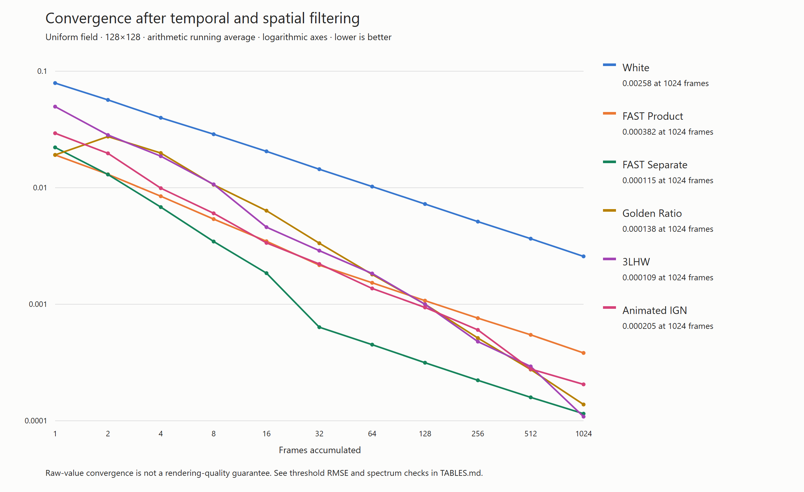
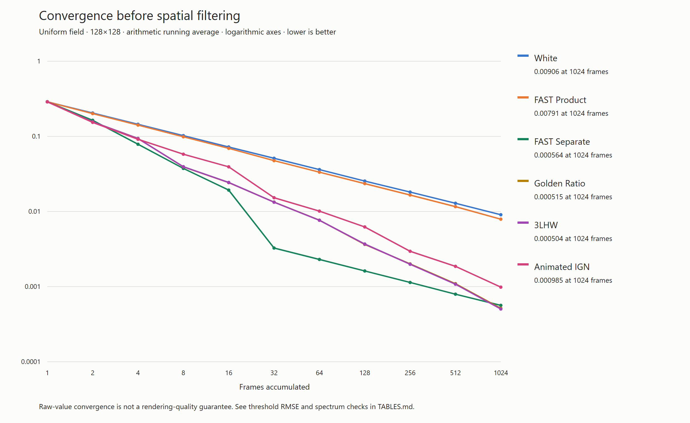
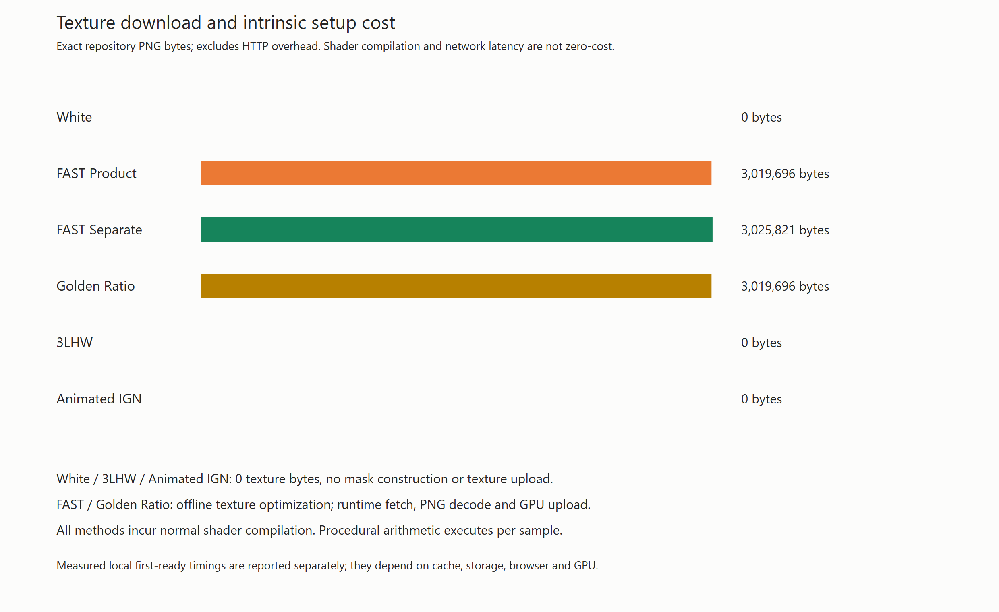
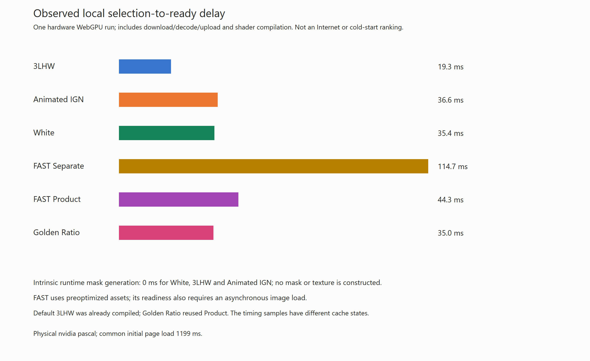

# Procedural noise comparison

This focused comparison extends the uniform-field chart and table in [Three.js PR 35244](https://github.com/mrdoob/three.js/pull/35244), pinned to `f14867640c96eb324665cb68948fccb12318231e`. FAST Product is the original **FAST Spatial** texture; FAST Separate is **FAST Spatio-Temporal**. The underlying texture metadata identifies the product and separate filters. All four original series are reproduced from the original textures and NumPy seed, rather than copied or fitted. All 88 original raw/blur data points match the original convergence script exactly at its five-decimal output precision. The PR body uses fewer displayed digits, sometimes rounding that five-decimal intermediate.









See [TABLES.md](TABLES.md) for numerical tables and nonlinear/spectral checks, and [results.json](results.json) for full precision, input hashes, arithmetic details, and small CPU reference fixtures. PNGs are ordinary raster charts; their SVG sources are included.

## Reproduce

From the repository root, with Python 3, NumPy, Pillow, Node.js and the repository npm dependencies installed:

```sh
python utils/noise-comparison/compare.py
node utils/noise-comparison/chart.js
python utils/noise-comparison/check-results.py
node utils/noise-comparison/check-results.js
```

`CHROME_PATH` can select installed Chrome for the chart rasterizer. Chart generation uses 2D SVG and does not measure rendering performance. It does not change repository-root build outputs.

The benchmark preserves the original 128×128 R-channel viewport, 32-slice FAST indexing, 37/71-pixel cycle shift, midpoint byte decoding, and seven-tap separable wrapped sigma=1 Gaussian. White is NumPy `default_rng(0)`, as in the original published benchmark. Procedural methods use seed 1, continuous frame indices 0 through 1023, and no artificial 32-frame restart or texture quantization. IGN explicitly rounds each arithmetic operation to float32. 3LHW uses unsigned 32-bit arithmetic, then converts its upper 24 bits to a unit float. Accumulation and statistics use float64. These are CPU reference quality numbers; GPU float fusion may cause small IGN differences.

The original Golden Ratio chart uses the full 32-bit Weyl fraction; its example
uses the upper 24 bits for float arithmetic. This inherited distinction and the
NumPy-versus-shader white realization are preserved when extending the chart.

`original-convergence.py` preserves the preceding benchmark source from
`bhouston/three.js` commit `bf71e556b63c20af6b5f7f61ba30bcb11461e9e6`.
The Python cross-check executes it unchanged and checks all 88 original points;
the JavaScript check independently verifies all 24 procedural fixtures.

## Interpretation

**3LHW** builds three scrambled hierarchy levels per queried pixel, combines them with a hashed 8×8 tile phase, and adds a 32-bit golden-ratio Weyl increment each frame. No tile is generated or stored. Its low-discrepancy temporal sequence eventually competes with FAST Separate on this particular uniform-value running-average metric, but it has substantially worse single-frame and short-history spatial quality. The 1024-frame crossing is not evidence of a general state-of-the-art advance. The threshold and spectrum diagnostics expose tradeoffs that a raw-value average alone misses.

**Animated IGN** evaluates interleaved gradient noise with a 5.588238-pixel diagonal translation per frame. Its spatial neighborhood stratification gives useful filtering behavior with very little code and no lookup. It is a practical screen-space dithering alternative, rather than a replacement for optimized spatiotemporal masks in arbitrary sampling domains. The translation is continuous here: restarting it at 64 frames would change the convergence result. Floating-point precision degrades at large coordinates/frame indices; these measurements cover only the stated 1024-frame range.

The additional nonlinear check thresholds each sample at probabilities 0.1, 0.5 and 0.9 before accumulation and reports RMSE against the true probability, including bias. The spectrum diagnostic summarizes the first 32 contiguous frames without wrapping the procedural sequence. Neither test covers moving objects, reprojection/disocclusion, multidimensional integration, importance sampling, scene-dependent visibility, or a production denoiser. The Gaussian wraps at viewport edges for exact comparability with the original chart; actual example blur has its own edge treatment.

## Download and startup cost

| Method | Texture bytes | Intrinsic mask construction at runtime |
|---|---:|---|
| White | 0 | None |
| FAST Product | 3,019,696 | None; preoptimized PNG must be fetched, decoded and uploaded |
| FAST Separate | 3,025,821 | None; preoptimized PNG must be fetched, decoded and uploaded |
| Golden Ratio | 3,019,696 | Uses the first slice of the Product PNG in this example |
| 3LHW | 0 | None; arithmetic per sample |
| Animated IGN | 0 | None; arithmetic per sample |

Zero intrinsic mask construction does **not** imply zero shader compilation, first draw, or per-sample cost. Texture byte counts are exact repository payload sizes, not estimated HTTP transfer sizes. Network latency and browser caching depend on deployment. The example validation report separately measures local selection-to-GPU-completion latency on a physical adapter; it is not a portable download-time benchmark. The procedural choices require no FAST PNG request.

`startup.json` records that one local run. The default 3LHW graph was already
compiled before reselection; Golden Ratio reused the Product atlas. These
different cache states make the graph an illustration of observed UI delay,
not a cold-start ranking. White, 3LHW and IGN have **0 ms intrinsic mask
precomputation** and **0 noise-image bytes**; their ordinary shader compilation
and rendering still take time. FAST masks are preoptimized offline, then require
image fetching, decoding and upload when selected.

## Example validation

The example defaults to 3LHW and loads no FAST PNG until a texture-based method
is selected. Both Sphere and Uniform modes, index resets, six procedural frame
indices through 1024, failed-load retry, stale selection handling and atlas
caching pass on physical NVIDIA GTX 1050 hardware, with both WebGPU and WebGL.
The independent procedural readbacks agree exactly at the sampled points.
Hardware reports are in `hardware-webgpu.json` and `hardware-webgl.json`.
The checked-in build modules used by the live demo also pass the WebGPU checks
(`hardware-built.json`), without rebuilding or committing generated outputs.

```sh
node utils/noise-comparison/check-example.js --root . --artifacts OUTPUT
node utils/noise-comparison/check-example.js --root . --backend webgl --artifacts OUTPUT_WEBGL
node utils/noise-comparison/check-example.js --root . --benchmark --artifacts OUTPUT_BENCHMARK
node utils/noise-comparison/check-example.js --root . --built --artifacts OUTPUT_BUILT
```

The checker serves current source modules and injects test access only into its
HTTP response. It changes no root build files. These are integration/quality
checks, not rendering throughput benchmarks. No scene-level superiority over
FAST is established.

## Sustained example throughput

The optional benchmark counts GPU-completed frames after a two-second warmup,
for at least five seconds per method, sequentially. Vsync and frame caps are
disabled. It includes the complete example workload: Uniform mode, 1000x700
display, 500x350 sampling target, arithmetic accumulation, spatial Gaussian
and final display. Eight frames are drained before counting; individual frames
are not timed. Atlases are already cached. Physical NVIDIA GTX 1050 / WebGPU:

| Method | Completed frames | Seconds | Frames/second |
| --- | ---: | ---: | ---: |
| 3LHW | 7,824 | 5.003 | 1,564 |
| Animated IGN | 7,768 | 5.002 | 1,553 |
| FAST Separate | 7,944 | 5.005 | 1,587 |
| FAST Product | 7,856 | 5.001 | 1,571 |
| Golden Ratio | 7,824 | 5.000 | 1,565 |
| White | 7,768 | 5.004 | 1,552 |

The small spread in this one run does not establish a speed ranking. CPU
submission, inspector updates, accumulation, blur and display are included;
this is not isolated sampler instruction cost or a prediction for path tracing.
The noise-download benefit remains separate from hot rendering throughput.

## Provenance

- [EA FAST / Donnelly et al.](https://github.com/electronicarts/fastnoise): original optimized textures and filter metadata; existing texture license remains beside them.
- [Jimenez, Next Generation Post Processing in Call of Duty: Advanced Warfare](https://www.iryoku.com/next-generation-post-processing-in-call-of-duty-advanced-warfare/): interleaved gradient noise.
- [Demofox, Interleaved Gradient Noise: A Different Kind of Low Discrepancy Sequence](https://blog.demofox.org/2022/01/01/interleaved-gradient-noise-a-different-kind-of-low-discrepancy-sequence/): neighborhood behavior and animated translation.
- 3LHW is the experimental `tiled-bayer-weyl` construction from the preceding PR 117 runtime exploration, renamed for this focused example. It combines established stratification, scrambling and Weyl-sequence ideas; no novelty or universal dominance is claimed.
