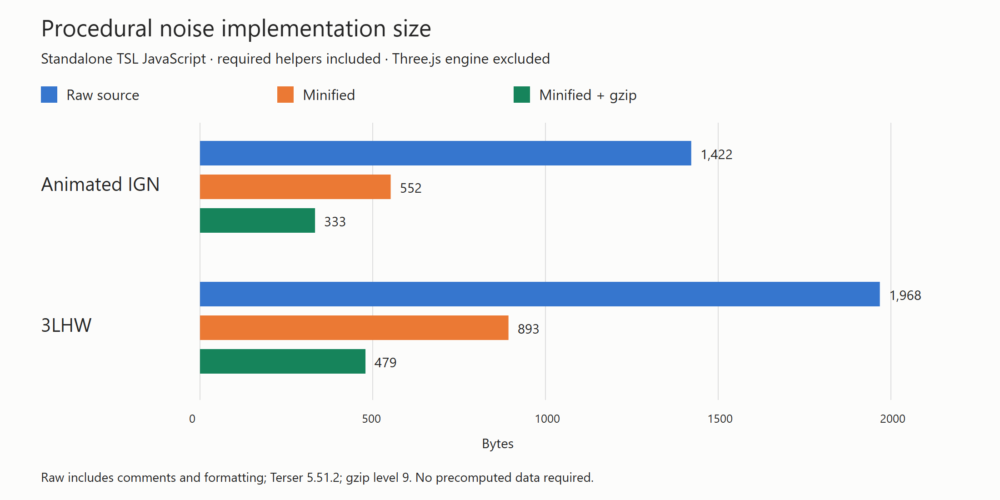

# Procedural noise code size



| Method | Raw source (bytes) | Minified (bytes) | Minified + gzip (bytes) |
| --- | ---: | ---: | ---: |
| Animated IGN | 1,422 | 552 | 333 |
| 3LHW | 1,968 | 893 | 479 |

These are standalone **TSL JavaScript implementation** sizes, taken directly from `examples/jsm/tsl/utils/ProceduralNoise.js`. Each method includes its required `three/tsl` named imports, its public function, and the complete shared `hashUint` helper. 3LHW also includes `pixelHash`. The shared helper is charged in full to each method, so either row represents using that method independently. Raw sizes include JSDoc and source formatting, normalized to LF and counted as UTF-8 bytes.

All setup and runtime implementation code is included. Neither method precomputes a texture, generates startup data, or downloads an asset. These sizes exclude the Three.js engine dependency, generated GPU shaders, example UI, and benchmark harness. They measure the additional source implementation required by an application already using Three.js/TSL, rather than the full application download or GPU binary size.

Reproduce after `npm ci`:

```sh
node utils/noise-comparison/code-size.js
```

For a worktree sharing another checkout's installed dependencies, optionally pass that checkout's absolute path as the first argument. Chrome is used only to rasterize the SVG chart into a PNG; `CHROME_PATH` overrides its executable. The script writes `code-size.json`, `code-size.svg`, and `code-size.png` alongside itself.

The checked-in results use Terser 5.51.2, with `module: true`, `compress: true`, `mangle: true`, and `format: { comments: false }`. Minified outputs retain the public export and external import. Gzip uses Node's `gzipSync` with level 9. `code-size.json` records exact input SHA-256 hashes and Node/zlib versions; compressed sizes can vary across compressor versions.
