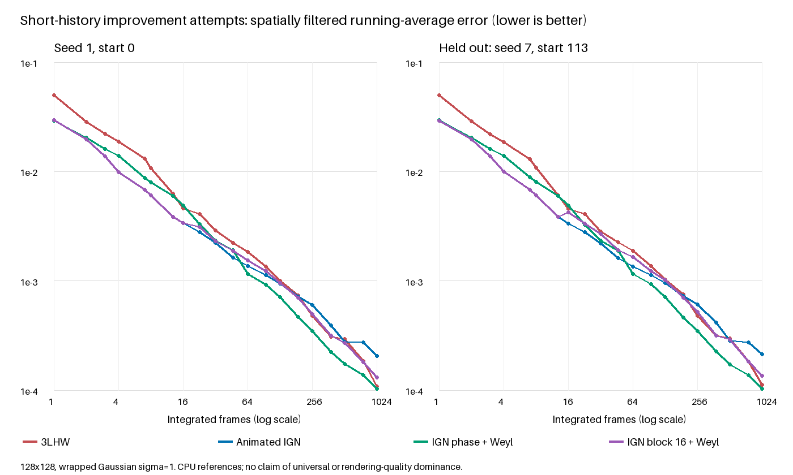

# Why 3LHW loses short histories, and improvement attempts

3LHW is an inexpensive compromise, not a joint spatiotemporal filter optimization. Its aligned 8×8 hierarchy distributes 64 ranks, but does not distribute values as evenly in the small **sliding** neighborhoods averaged by the Gaussian filter. Animated IGN does that better. Temporal Weyl coverage eventually helps 3LHW, but cannot repair its first frame.

There is no fixed 128-frame crossover: in the original chart 3LHW beats IGN at 256, loses again at 512, and wins at 1024. The answer depends on the integrand, filter and accumulation window.

## Measured cause

`diagnose.py` measures frame zero using the original seed and 128×128 domain. For each overlapping wrapped 3×3 neighborhood it sorts nine values, includes the circular last-to-first gap, and measures RMS deviation from the ideal gap 1/9. 3LHW scores **0.06924**, versus **0.03054** for IGN: substantially less even local coverage. This diagnostic is not a universal noise-quality metric.

3LHW's phase is `rank/64 + tilePhase (mod 1)`. Consequently its 64th phase harmonic `exp(2πi*64*phase)` is constant throughout each 8×8 tile. Its filtered RMS magnitude is **0.864**, versus **0.0289** for IGN. This is a concrete example of spatially coherent residuals, not a claim that this harmonic alone explains the first-frame error. Removing the tile phase improves first-frame standard deviation from .04967 to .03981 but leaves bias and still trails IGN's .02936. Boundary and interior RMSE are almost equal in the original hierarchy, so blaming only tile seams is incorrect.

A common Weyl progression rotates every pixel's phase by the same amount. In a Fourier description its finite-history multiplier at harmonic k has magnitude `abs(sin(pi*N*k*alpha)/(N*sin(pi*k*alpha)))`. It oscillates with N; particular sample counts suppress or preserve different spatial residuals. Better long-history discrepancy does not imply better Gaussian-filtered error at every prefix.

IGN's small-neighborhood coverage is discussed in [Demofox's primary analysis](https://blog.demofox.org/2022/01/01/interleaved-gradient-noise-a-different-kind-of-low-discrepancy-sequence/). The original graphics use is [Jimenez's post-processing presentation](https://www.iryoku.com/next-generation-post-processing-in-call-of-duty-advanced-warfare/). Combining spatial error distribution and temporal stratification is an established direction; these experiments do not establish a state-of-the-art improvement.

## What improved

Three independent explorations retain all results: [spatial](SPATIAL.md) (61 screened variants), [temporal](TEMPORAL.md) (12 profiles including baselines), and [IGN/Weyl hybrids](IGN-PHASE.md) (15 profiles including baselines). The latter includes 20 sample counts, two held-out seed/window pairs, threshold functions and a squared integrand. These are exploratory holdouts, not a sufficiently broad rendering evaluation.

The most promising simple candidate uses an **IGN-derived spatial phase + Weyl**. It improves 3LHW at many endpoints while retaining strong late convergence:

| Frames | Animated IGN | Original 3LHW | IGN-derived phase + Weyl |
| --- | ---: | ---: | ---: |
| 1 | .02936 | .04967 | .0293 |
| 8 | .00603 | .01069 | .00800 |
| 16 | .00336 | .00459 | .00490 |
| 64 | .00137 | .00184 | .00115 |
| 128 | .000939 | .000999 | .000710 |
| 512 | .000278 | .000293 | .000173 |
| 1024 | .000205 | .000109 | .000103 |

Values are Gaussian-filtered standard deviations of the arithmetic sample mean, seed 1/start 0. This candidate cuts original 3LHW's first-frame error by about 41%, but at 16 frames is worse than both original methods. Its 1024-frame error is approximately 48–49% of Animated IGN in the held-out windows. Exact formula, precision and seed differences from the production IGN helper are documented in IGN-PHASE.md.

A 16-frame IGN block with a Weyl shift preserves the original first 16 samples **only for aligned start zero** and improves long convergence. Unaligned held-out windows expose a 27–28% loss at 16 frames. Changing temporal increments alone moves the good endpoints around. Antithetic pairs give an artificial exact result for the linear mean while losing on threshold integration; ordered few-value patterns can similarly hide bias behind small standard deviation. Neither is a general solution.

## Recommendation and limits

Keep Animated IGN as the stronger existing choice for short-history filtered sampling. The IGN-derived phase/Weyl candidate is worth a subsequent shader prototype when long-history scalar convergence matters, but does not justify replacing either current helper yet. All candidates need float32 GPU validation, spectra, moving/disoccluded histories, exponential temporal filters, multiple sample dimensions and actual rendered integration errors. No new GPU performance or rendering-quality claim is made here; these changes add CPU research and leave the example samplers unchanged.

Reproduce with the NumPy environment used for `compare.py`: run `spatial.py`, `temporal.py`, `ign-phase.py`, `diagnose.py`, then `chart.py` (Pillow required). `chart.py` independently cross-checks all shared original raw/blur 3LHW/IGN endpoints before drawing. JSON files preserve unrounded results and failed candidates.

Validation: all 88 original benchmark points reproduce; all 24 independent NumPy/JS fixtures agree; new chart checks 44 shared raw/blur endpoints. Scoped example/helper/utility ESLint passes. Repository npm test passes: 1982 core tests, one TODO, 141 addon tests, zero failures. The Windows launcher was temporarily configured to prohibit software rasterization and omit its Linux Vulkan driver override, then restored. This turn does not validate new candidates on a GPU; production helpers are unchanged. No separate typecheck script is defined in this JavaScript repository.

